# Plasmoid Visualizer — Codebase Audit & Improvement Plan

**Repository:** `d:\Projekty\visualizerv2`  
**Audit Date:** 2026-11-20  
**Scope:** ~7.5k lines of first-party C++17 code (`src/`), 8 GLSL shaders (`assets/shaders/`), 3 standalone unit tests (`tests/`), CMake build, packaging scripts, and documentation. Vendored libraries (`third_party/`, `glew-2.3.1/`, `glfw-3.4.bin.WIN64/`, `glm/`, `include/`) and build artifacts were excluded from code modification scope.

---

## 1. Executive Summary

- **Real-time audio thread is unsafe and racy (`TH-01`–`TH-04`):** `AudioEngine::dataCallback` acquires `std::mutex`, allocates heap memory (`m_circularBuffer.resize`), calls `rand()`, logs to `std::cerr`, and seeks `ma_decoder` (doing file I/O) on the real-time thread. Control flags and `ma_decoder` are read/written across threads without synchronization, and `dataCallback` can even seek an uninitialized `ma_decoder` (`COR-03`).
- **OS command injection in both FFmpeg integrations (`SEC-01`):** `VideoRenderManager::buildFfmpegCommand` and `AnimatedBackground::startVideo` concatenate user-supplied file paths into shell strings passed to `_wpopen`/`popen`, allowing arbitrary command execution via crafted filenames and failing on quotes/special characters.
- **OpenGL context teardown bug causes UB on exit (`ROB-01`):** `Visualizer`, `ParticleSystem`, `RenderManager`, and `VideoRenderManager` are stack-allocated before `glfwDestroyWindow`/`glfwTerminate` in `main.cpp`, so their destructors invoke `glDelete*` after the OpenGL context is already destroyed. `RenderManager` also leaks its offline capture FBO/texture/RBO.
- **Video export has severe correctness, overflow, and performance bugs (`COR-02`, `COR-04`, `COR-05`, `PERF-03`, `ROB-03`):** `glReadPixels(..., GL_RGB)` lacks `GL_PACK_ALIGNMENT = 1` (heap overflow whenever `(width * 3) % 4 != 0`), mono/surround audio downmix is hardcoded for 2 channels, live and offline renders thrash shared FBOs every tick (wiping CRT phosphor persistence on every video frame), `RenderManager.cpp:434` constructs an 832 KB `AudioEngine dummyAudio` on every offline frame, `-c:a copy` breaks WAV/PCM sources, and FFmpeg exit codes/pipe failures are ignored.
- **100% single-core CPU spin & 60–144×/s OS audio re-enumeration (`PERF-01`, `PERF-02`):** Turning VSync off enters a busy-wait `while` loop burning an entire CPU core. Opening Capture mode calls `AudioEngine::getAvailableDevices(true)` (full `ma_context_init`/`uninit`) on every UI frame.
- **Heavy redundant per-frame CPU and GPU work (`PERF-04`, `PERF-05`):** With 5 spectrum layers + default Media Overlay, the app computes 7 full 8192-point FFTs per frame (recalculating 57,344 `cosf()` Hanning weights/frame), issues ~274+ separate draw calls and 2,000+ uncached `glGetUniformLocation` lookups/frame for overlay bars and text, runs an `O(N × period)` XY correlation loop every frame regardless of UI state, and executes 12–20 FBO passes per frame even with no XY layers or active lyrics.
- **Silent data loss and unwired features (`COR-01`, `COR-06`):** `ConfigLogic` never saves or loads `globalGain`, `enableVsync`, or `targetFps`. Particle physics sliders never call `ParticleSystem` setters. XY settings edited in `Profile`/`Acquisition` are silently reverted on save by stale legacy fields. Lyrics Timeline edits are lost on save. `File > Exit` is a no-op.
- **Fragile error handling and edge cases (`ROB-02`, `ROB-04`, `ROB-05`):** `glewInit()` return code is ignored, no OpenGL 3.3 Core Profile is requested (`renderGrid()` uses OpenGL 1.x `glBegin`/`glEnd`), minimizing to `0×0` causes NaN aspect ratios / FBO spam / FFmpeg spawn storms, and untrusted `config.toml` values (e.g., negative `num_bars`) can trigger immediate OOM or unterminated `strncpy` buffers.
- **Maintainability bottlenecks (`MNT-01`–`MNT-04`):** `AppState` is a god struct mixing persisted config, per-frame FX state, UI flags, dead fields, and ~20 KB of fixed `char[]` buffers. `Visualizer.cpp` (837 lines) and `RenderManager.cpp` (725 lines, ~85% duplicated between live and offline paths) bundle too many responsibilities. Function-local `static` UI state in `AudioSettingsPanel.cpp` desyncs from `AppState`.
- **Build, test, and doc drift (`BLD-01`, `BLD-02`, `DOC-01`, `TST-01`):** Debug builds link static Release `glfw3.lib` (reproducing `LNK4098` CRT conflicts), `glew32.dll` is missing from build output directories, warning flags and CI are absent, only 3 small tests exist (zero coverage of config, LRC, FFT, or OscMusic), and `README.md`/`package.sh` still reference a deleted `plasma_widget/` directory.

---

## 2. Architecture Overview

### Module Dependency Diagram

```mermaid
flowchart TD
    Main["app/main.cpp"] --> AppState["app/AppState"]
    Main --> AssetPaths["app/AssetPaths"]
    Main --> AudioEngine["audio/AudioEngine"]
    Main --> AnalysisEngine["audio/AnalysisEngine"]
    Main --> OscMusic["audio/OscMusicEditor"]
    Main --> ConfigLogic["config/ConfigLogic"]
    Main --> RenderManager["rendering/RenderManager"]
    Main --> Visualizer["rendering/Visualizer"]
    Main --> Particles["rendering/ParticleSystem"]
    Main --> UIManager["ui/UIManager + panels/*"]
    Main --> VideoRender["export/VideoRenderManager"]
    Main --> SystemStats["platform/SystemStats"]

    AudioEngine --> Utf8Paths["platform/Utf8Paths"]
    AudioEngine --> XYTypes["rendering/XYOscilloscopeTypes"]

    ConfigLogic --> AppState
    ConfigLogic --> ConfigManager["config/ConfigManager"]
    ConfigLogic --> Utf8Paths
    ConfigManager --> Utf8Paths
    ConfigManager --> XYTypes

    AppState --> AnalysisEngine
    AppState --> VisTypes["rendering/VisualizerTypes"]
    AppState --> XYTypes
    AppState --> OverlayPreset["rendering/OverlayPreset"]

    RenderManager --> AppState
    RenderManager --> AudioEngine
    RenderManager --> AnalysisEngine
    RenderManager --> Visualizer
    RenderManager --> Particles
    RenderManager --> Bloom["rendering/BloomRenderer"]
    RenderManager --> Blur["rendering/GaussianBlurRenderer"]
    RenderManager --> XYEngine["rendering/XYOscilloscopeEngine"]
    RenderManager --> OverlayPreset
    RenderManager --> AnimBg["rendering/AnimatedBackground"]
    RenderManager --> Framebuffer["rendering/Framebuffer"]

    Visualizer --> Shader["rendering/ShaderProgram"]
    Visualizer --> Framebuffer
    Visualizer --> Texture2D["rendering/Texture2D"]
    Visualizer --> FontAtlas["rendering/FontAtlas"]
    Visualizer --> VisGeo["rendering/VisualizerGeometry"]
    Visualizer --> AssetPaths
    Visualizer --> Utf8Paths

    Bloom --> Shader
    Bloom --> Framebuffer
    Blur --> Shader
    Blur --> Framebuffer
    Particles --> Shader
    AnimBg --> Utf8Paths
    AnimBg --> OverlayPreset
    OverlayPreset --> Visualizer

    VideoRender --> AppState
    VideoRender --> AudioEngine
    VideoRender --> RenderManager
    VideoRender --> Utf8Paths

    UIManager --> AppState
    UIManager --> AudioEngine
    UIManager --> OscMusic
    UIManager --> Particles
    UIManager --> SystemStats
    UIManager --> ConfigLogic
    UIManager --> VideoRender
    UIManager --> Utf8Paths
```



### Per-Frame Data Flow Diagram

```mermaid
flowchart LR
    subgraph AudioThread["miniaudio RT Callback Thread"]
        Src["ma_decoder / WASAPI Capture / TestTone / OscMusic"] -->|"locks m_bufferMutex"| RingBuf["Ring Buffers\nm_circularBuffer (8192 mono)\nm_stereoBuffer (65536 XY) + Z"]
    end

    subgraph BgThread["AnimatedBackground Thread (optional)"]
        FFIn["FFmpeg stdout pipe\n(-stream_loop -1)"] -->|"fread + CPU flipRows\nlocks m_videoFrameMutex"| PendingTex["m_pendingVideoFrame (RGBA)"]
    end

    subgraph MainThread["Main / OpenGL / ImGui Thread"]
        RingBuf -->|"getBuffer (8192)"| InitFFT["analysisEngine.computeFFT\n+ m_overlayAnalysis.computeFFT\n(duplicate FFTs)"]
        InitFFT --> Beat["detectBeat -> Particles + Zen-Kun"]
        PendingTex -->|"glTexSubImage2D"| BgPass["Pass 0: Backgrounds\n(Zen-Kun + MediaOverlay)"]
        RingBuf -->|"readXYSince"| XYCont["XYOscilloscopeEngine\nprocessContinuous"]
        XYCont --> PersPass["Pass 1: Persistence FBO\n+ Slow Phosphor FBO"]
        BgPass --> PersPass
        Beat --> PersPass

        RingBuf -->|"getChannelBuffer per layer\n+ snapshotXY"| DirectAnalysis["Per-Layer FFT / Waveform /\nXY processTriggered"]
        PersPass --> ScenePass["Pass 2: HDR Scene FBO\n(Graticule + Persistence + Direct Layers)"]
        DirectAnalysis --> ScenePass

        ScenePass --> OutputPass["Pass 3: Output FBO\n(Scene + 8-pass BloomRenderer)"]
        ScenePass -->|"8-pass GaussianBlurRenderer"| OverlayPass["Pass 4: MediaOverlay\n(Text + Top/Bottom Spectra + Blurred Band)"]
        OutputPass --> OverlayPass

        OverlayPass --> ExportBranch{"videoStatus.isRendering?"}
        ExportBranch -->|"Yes (1 frame/tick)"| Offline["renderOfflineFrame -> glReadPixels\n-> blocking fwrite -> FFmpeg stdin pipe"]
        ExportBranch -->|"No"| UIPass["ImGui Panels (UIManager)\nreads/mutates AppState + AudioEngine"]
        Offline --> UIPass
        UIPass --> Swap["glfwSwapBuffers + Busy-Wait Limiter"]
    end
```



### Module Descriptions

| Directory / Module | Files | Responsibility |
|---|---|---|
| `src/app/` | `main.cpp`, `AppState.*`, `AssetPaths.*` | GLFW/GLEW/ImGui initialization, main loop, fullscreen toggle, ImGui font rebuilding, central application state container (`AppState`), and relative asset/font path lookup. |
| `src/audio/` | `AudioEngine.*`, `AnalysisEngine.*`, `OscMusicEditor.*` | `miniaudio` playback/capture/loopback/test-tone/OscMusic audio callback and ring buffers; KissFFT spectral analysis, logarithmic binning, and beat detection; `tinyexpr`-based `X(t)/Y(t)/Z(t)` oscilloscope music synthesis. |
| `src/config/` | `ConfigManager.*`, `ConfigLogic.*` | `toml++` serialization/deserialization to `%APPDATA%/PlasmoidVisualizerStd/config.toml` (or `~/.config/...`), bidirectional mapping between `AppConfig` and `AppState`, and music folder scanning. |
| `src/export/` | `VideoRenderManager.*` | Offline video rendering orchestration: builds FFmpeg CLI, opens pipe, reads audio frames via `AudioEngine`, invokes `RenderManager::renderOfflineFrame`, reads back RGB pixels, and pipes raw frames to FFmpeg. |
| `src/platform/` | `SystemStats.*`, `Utf8Paths.*` | Process/global CPU, RAM, and GPU/VRAM telemetry (Win32 + GL extensions on Windows; `/proc` on Linux); UTF-8 ↔ `std::filesystem::path` / `std::wstring` conversion helpers. |
| `src/rendering/` | `RenderManager.*`, `Visualizer.*`, `VisualizerGeometry.*`, `XYOscilloscopeEngine.*`, `OverlayPreset.*`, `AnimatedBackground.*`, `BloomRenderer.*`, `GaussianBlurRenderer.*`, `ParticleSystem.*`, `Framebuffer.*`, `ShaderProgram.*`, `Texture2D.*`, `FontAtlas.*` | Multi-pass OpenGL 3.3 rendering pipeline (persistence FBO, slow phosphor FBO, HDR scene FBO, 8-pass bloom, 8-pass Gaussian blur, Media Overlay with LRC lyrics and stb_truetype glyph atlas, looped still/GIF/video backgrounds, particles, and XY oscilloscope signal conditioning/triggering/measurements). |
| `src/ui/` | `UIManager.*`, `UIHelpers.hpp`, `panels/*.cpp` | Dear ImGui menu bar and panels: `AudioSettingsPanel`, `BackgroundPanel`, `DiagnosticsPanels`, `LayerPanels`, `LyricsEditorPanel`, `PlaybackPanels`. |
| `tests/` | `VisualizerGeometryTests.cpp`, `XYOscilloscopeEngineTests.cpp`, `Utf8PathsTests.cpp` | 3 standalone CTest executables (153 LOC total) verifying Catmull-Rom/ribbon math, XY continuous/triggered processing, and Japanese UTF-8 path round-trips. |

---

## 3. Threading Model

### Thread Inventory

1. **Main / OpenGL / UI Thread** (`src/app/main.cpp`): Runs GLFW event polling, ImGui panels, `ConfigLogic`, `AnalysisEngine`, all OpenGL rendering (`RenderManager`, `Visualizer`, `ParticleSystem`), `VideoRenderManager::update()` (including synchronous `glReadPixels` and blocking `fwrite` to the FFmpeg export pipe), and `AudioEngine` control methods.
2. **miniaudio Real-Time Audio Callback Thread** (`AudioEngine::dataCallback` in `src/audio/AudioEngine.cpp:42-249`): Driven by WASAPI (Windows) or PipeWire/PulseAudio/ALSA (Linux). Produces playback samples (decoder, test tone, OscMusic) or consumes capture/loopback samples, and populates visualization ring buffers.
3. **AnimatedBackground Video Reader Thread** (`AnimatedBackground::videoReaderLoop` in `src/rendering/AnimatedBackground.cpp:228-240`): Spawned only when `MediaOverlayLayer` uses `OverlayBackgroundType::LoopedVideo` in realtime mode. Reads raw RGBA frames from an FFmpeg stdout pipe, flips rows on CPU, and posts frames to the main thread.
4. **External Subprocess Pipes**:
   - Export FFmpeg child process (`VideoRenderManager::m_pipe`, stdin write pipe via `_wpopen`/`popen`, fed synchronously on the main thread).
   - Looped background FFmpeg child process (`AnimatedBackground::m_videoPipe`, stdout read pipe via `_wpopen`/`popen`, drained on `m_videoThread` in realtime mode or synchronously on the main thread in offline mode).

### Shared State Matrix

| Shared State | Writer Thread | Reader Thread | Sync | Verdict |
|---|---|---|---|---|
| `AudioEngine::m_circularBuffer`, `m_writePos` | Audio callback (`AudioEngine.cpp:95,145,181,238`) | Main (`getBuffer`, `getChannelBuffer`) | `m_bufferMutex` | **RT-Unsafe:** Mutex blocks RT thread; `m_circularBuffer.resize(8192)` allocates on RT thread (`TH-01`). |
| `AudioEngine::m_stereoBuffer`, `m_zBuffer`, `m_zValidBuffer`, `m_stereoWritePos`, `m_xyFrameCounter`, `m_xyValidFrames`, `m_xyDiscontinuityGeneration` | Audio callback (`writeXYFrameUnlocked`); Main (`markXYDiscontinuity`) | Main (`getStereoBuffer`, `readXYSince`, `snapshotXY`, `latestXYFrame`) | `m_bufferMutex` | **RT-Unsafe:** Contended with main thread & huge `setOscMusicBuffer` copies (`TH-01`, `TH-04`). |
| `AudioEngine::m_oscMusicBuffer`, `m_oscMusicZBuffer`, `m_oscMusicReadPos` | Main (`setOscMusicBuffer`, `AudioEngine.hpp:68-79`); Audio callback (`m_oscMusicReadPos`) | Audio callback (`AudioEngine.cpp:118-138`) | `m_bufferMutex` | **RT-Unsafe (Priority Inversion / Stall):** Main thread copies up to ~23 MB while holding `m_bufferMutex` (`TH-04`). |
| `AudioEngine::m_decoder` | Audio callback (`ma_decoder_read_pcm_frames`, `ma_decoder_seek_to_pcm_frame` at `191,205,247`); Main (`seekTo:558`, `readAudioFrames:257,264`, `loadFile:385,392`) | Audio callback (`191,203,214`); Main (`getPosition:552`, `getDuration:565`, `getChannels:575`) | **Broken:** Only `readAudioFrames` locks `m_bufferMutex`; callback, `getPosition`, `getDuration`, `seekTo` are **unlocked** | **DATA RACE (Critical):** Concurrent unlocked access to non-thread-safe `ma_decoder` every frame during playback and if Play is clicked during export (`TH-02`). |
| `AudioEngine::m_isDecoderInitialized` | Main (`loadFile:386,400,414`) | Audio callback (`189,214`); Main (`readAudioFrames`, `getPosition`, `seekTo`, `getDuration`) | **None** (plain `bool`) | **DATA RACE (High):** Plain `bool` accessed across threads; device is uninitialized during `loadFile`, but `startCapture` leaves it true if previously loaded (`TH-03`). |
| `AudioEngine::m_isCaptureMode` | Main (`startCapture:453` **after** `ma_device_start:446`, `resetDevice:352`, `stopCapture:544`) | Audio callback (`154`) | **None** (plain `bool`) | **DATA RACE (Critical):** Written *after* `ma_device_start()`, racing immediately with first capture callbacks (`TH-03`). |
| `AudioEngine::m_testTone`, `m_testToneType`, `m_testToneFrequency`, `m_testToneFrequencyRight`, `m_testToneStereo`, `m_testToneVolume` | Main (`AudioEngine.hpp:58-63`, `AudioEngine.cpp:355,482`) | Audio callback (`47,65,72,75,77,84,102,106`) | **None** (plain `bool`/`float`/enum) | **DATA RACE (High):** Unsynchronized writes from UI sliders while audio thread reads every callback (`TH-03`). |
| `AudioEngine::m_oscMusicMode` | Main (`AudioEngine.hpp:67`, `AudioEngine.cpp:354`) | Audio callback (`113`) | **None** (plain `bool`) | **DATA RACE (High):** Plain `bool` toggled while device may be active (`TH-03`). |
| `AudioEngine::m_isPlaying`, `m_currentSampleRate` | Main (`loadFile`, `startCapture`, `initTestTone`, `initOscMusic`, `play`, `pause`, `stop`) | Main (`isPlaying`, `getSampleRate`) | **None** (plain `bool`/`ma_uint32`) | **Safe today (Main-only), brittle:** Neither is read by `dataCallback` currently, but `startCapture` mutates them after `ma_device_start`. Recommend `std::atomic` for safety. |
| C runtime RNG state (`rand()`) | Audio callback (`AudioEngine.cpp:70,82`) & Main (`RenderManager.cpp:126-129,364-367`) | Both | Internal CRT lock (MSVC) / **None** (glibc/BSD) | **RT-Unsafe / Data Race:** Global lock or data race on `rand()` state during TestTone white noise + Zen-Kun shake (`TH-01`). |
| `AnimatedBackground::m_pendingVideoFrame`, `m_pendingVideoFrameReady` | `m_videoThread` (`AnimatedBackground.cpp:236-237`) | Main (`AnimatedBackground.cpp:298-300`) | `m_videoFrameMutex` | **Synchronized, but high contention:** 8.3 MB frame copied under lock on reader thread; `glTexSubImage2D` runs under lock on main thread (`TH-05`). |
| `AnimatedBackground::m_stopVideoThread` | Main (`stopVideo:121`, `startVideo:209`) | `m_videoThread` (`videoReaderLoop:230`) | `std::atomic<bool>` | **Hang/Deadlock Risk:** `stopVideo()` joins `m_videoThread` *before* closing `m_videoPipe`, while `m_videoThread` may block in `fread()` on an infinite `-stream_loop -1` FFmpeg pipe (`TH-05`). |
| `AnimatedBackground::m_videoPipe`, `m_videoWidth`, `m_videoHeight`, `m_videoFrame` | Main (`startVideo` before thread launch; `stopVideo` after `join()`) | `m_videoThread` (`videoReaderLoop:229-233`) | Thread spawn/join happens-before | **Synchronized via lifecycle**, provided `stopVideo()` always joins before touching pipe/dimensions. |

---

## 4. Findings

### Threading

#### `TH-01`: Real-Time Audio Callback Locks Mutex, Allocates Heap Memory, Calls `rand()`, Logs, and Seeks File I/O
- **Category:** Threading
- **Severity:** Critical | **Effort:** M
- **Evidence:** `src/audio/AudioEngine.cpp:51-57, 70, 82, 116, 144-149, 162-165, 197, 205, 212-224, 247`
  ```cpp
  // src/audio/AudioEngine.cpp:51-57 (similar at 116/144-148, 162-165, 212-224)
  std::lock_guard<std::mutex> lock(pEngine->m_bufferMutex);
  if (pEngine->m_circularBuffer.size() < 8192) {
      pEngine->m_circularBuffer.resize(8192, 0.0f);
  }
  ```
  ```cpp
  // src/audio/AudioEngine.cpp:197, 205
  std::cerr << "Decoder read error: " << result << std::endl;
  ...
  ma_decoder_seek_to_pcm_frame(&pEngine->m_decoder, 0);
  ```
- **Impact:** Blocking on `m_bufferMutex`, calling `std::vector::resize` (which *always* triggers for `m_circularBuffer` on the first callback because the constructor at lines 8–12 only pre-sizes `m_stereoBuffer`), acquiring the CRT lock in `rand()`, flushing `std::cerr`, and doing disk I/O seeks on the real-time audio thread cause priority inversion, audio dropouts/glitches, and XRuns—especially at 192 kHz with small WASAPI/PipeWire buffer periods. Notice also that lines 144 & 148 check `resize()` inside the per-sample loop in `oscMusicMode`.
- **Proposed fix:** Preallocate `m_circularBuffer` (8192) alongside `m_stereoBuffer`/`m_zBuffer`/`m_zValidBuffer` in `AudioEngine::AudioEngine()`. Replace the mutex-guarded ring buffers with a lock-free SPSC ring buffer (single writer = audio thread, single reader = main thread) using atomic write/read indices with release/acquire semantics. Replace `rand()` with a local `uint32_t` xorshift PRNG state owned by the audio thread. Replace `std::cerr` with an atomic error counter read on the UI thread.
- **Risk of fix:** Medium — SPSC ring buffers must handle wraparound and overrun cleanly without losing `XYInputChunk` discontinuity generation tracking; unit-test thoroughly with synthetic producer/consumer tests.

#### `TH-02`: Unsynchronized Concurrent Access to `ma_decoder` Across Audio and Main Threads
- **Category:** Threading
- **Severity:** Critical | **Effort:** M
- **Evidence:** `src/audio/AudioEngine.cpp:191, 205, 247, 255-264, 549-567`
  ```cpp
  // Audio thread (NO lock):
  ma_result result = ma_decoder_read_pcm_frames(&pEngine->m_decoder, pOutput, frameCount, &framesRead64); // :191

  // Main thread (NO lock, called every frame via RenderManager.cpp:76,250 & UI panels):
  ma_decoder_get_cursor_in_pcm_frames((ma_decoder*)&m_decoder, &cursor); // :552
  ma_decoder_seek_to_pcm_frame(&m_decoder, frameIndex);                 // :558
  ma_decoder_get_length_in_pcm_frames((ma_decoder*)&m_decoder, &length);// :565

  // Main thread during video export (locks m_bufferMutex, which callback does NOT hold at :191):
  std::lock_guard<std::mutex> lock(m_bufferMutex);                      // :255
  ma_result result = ma_decoder_seek_to_pcm_frame(&m_decoder, (ma_uint64)offsetFrames);
  ```
- **Impact:** `ma_decoder` is not thread-safe. During normal playback, `getPosition()` and `getDuration()` run every frame from the main thread while `dataCallback` decodes concurrently, and scrubbing the progress slider calls `ma_decoder_seek_to_pcm_frame` concurrently with `ma_decoder_read_pcm_frames`—causing corrupted decoder state, audio glitches, or crashes (especially on compressed codecs like FLAC/MP3/OGG). During video export, nothing disables the `Play` button (`AudioSettingsPanel.cpp:98`) or `Playlist` (`PlaybackPanels.cpp:35`), allowing live playback to race `readAudioFrames()`.
- **Proposed fix:**
  1. Give `VideoRenderManager` its own dedicated `ma_decoder` instance opened on `state.filePath` for the duration of an export session (eliminating `AudioEngine::readAudioFrames` touching the playback decoder entirely).
  2. Cache file duration (`m_cachedDurationFrames`) once on `loadFile()` instead of calling `ma_decoder_get_length_in_pcm_frames` every frame.
  3. Track playback cursor with an `std::atomic<uint64_t> m_playbackFrameCursor` updated by the audio callback, and pass seek requests from UI to audio thread via an `std::atomic<int64_t> m_pendingSeekFrame` (sentinel `-1`) so **only** the audio thread touches `m_decoder` while the device is running.
- **Risk of fix:** Low–Medium — cleanly separates ownership of `m_decoder`; slight UI cursor granularity (one audio period, ~5–10 ms), which is imperceptible.

#### `TH-03`: Unsynchronized Control Flags, Test-Tone Parameters, and Post-Start Capture Race
- **Category:** Threading
- **Severity:** High | **Effort:** S
- **Evidence:** `src/audio/AudioEngine.hpp:91-93, 105, 111-116, 120, 123`; `src/audio/AudioEngine.cpp:446-455`
  ```cpp
  // AudioEngine.cpp:446-455
  if (ma_device_start(&m_device) != MA_SUCCESS) { ... }

  m_isDeviceInitialized = true;
  m_isCaptureMode = true;    // Written AFTER audio callback thread is already running!
  m_isPlaying = true;
  m_currentSampleRate = 48000;
  ```
- **Impact:** Plain `bool`, `float`, and enum fields written by the UI thread and read in `dataCallback` are C++17 data races (undefined behavior). Worse, `startCapture()` calls `ma_device_start()` *before* setting `m_isCaptureMode = true`: the first callbacks see `m_isCaptureMode == false` and fall through to `else if (m_isDecoderInitialized)` (trying to read into `pOutput == nullptr` if a file had been loaded previously!) or `else` followed by line 247 seeking `m_decoder`.
- **Proposed fix:** Change all cross-thread flags and parameters (`m_isDecoderInitialized`, `m_isCaptureMode`, `m_oscMusicMode`, `m_isPlaying`, `m_currentSampleRate`, `m_testTone`, `m_testToneType`, `m_testToneFrequency`, `m_testToneFrequencyRight`, `m_testToneStereo`, `m_testToneVolume`) to `std::atomic<T>` with `memory_order_relaxed` (or `release`/`acquire` for mode transitions). Set `m_isCaptureMode = true` and `m_currentSampleRate` **before** calling `ma_device_start()`.
- **Risk of fix:** Very Low — drop-in atomic replacements with negligible overhead.

#### `TH-04`: `setOscMusicBuffer` Performs Multi-Megabyte Copies Under Audio Callback Mutex
- **Category:** Threading
- **Severity:** High | **Effort:** M
- **Evidence:** `src/audio/AudioEngine.hpp:68-79`
  ```cpp
  void setOscMusicBuffer(const std::vector<float>& buffer, const std::vector<float>& z) {
      std::lock_guard<std::mutex> lock(m_bufferMutex);
      m_oscMusicBuffer = buffer;
      m_oscMusicZBuffer = z;
      m_oscMusicReadPos = 0;
  }
  ```
- **Impact:** At 192 kHz × 10 seconds (`AudioSettingsPanel.cpp:193, 234`), `buffer` holds 3.84M floats (15.4 MB) and `z` holds 1.92M floats (7.7 MB). Allocating and copying ~23 MB while holding `m_bufferMutex` blocks `dataCallback` for milliseconds, causing audible pops/dropouts.
- **Proposed fix:** Accept buffers by value (`std::vector<float>`) and swap into an immutable `std::shared_ptr<const OscMusicClip>` published atomically (or swapped under a dedicated tiny pointer-swap lock / deferred reclamation queue so the audio thread never frees memory).
- **Risk of fix:** Low — ensure the audio thread never triggers the last `shared_ptr` refcount drop (reclaim previous clip pointer on the main thread on next update/load).

#### `TH-05`: `AnimatedBackground` Video Thread Hang Risk on Shutdown and Heavy Mutex Contention
- **Category:** Threading
- **Severity:** High | **Effort:** M
- **Evidence:** `src/rendering/AnimatedBackground.cpp:119-130, 228-240, 296-301`
  ```cpp
  // stopVideo() :119-128
  void AnimatedBackground::stopVideo() {
      if (!m_videoPipe) return;
      m_stopVideoThread = true;
      if (m_videoThread.joinable()) m_videoThread.join(); // Blocks while thread waits in fread()!
      _pclose(m_videoPipe);
      m_videoPipe = nullptr;
  }
  // videoReaderLoop() :235-238
  std::lock_guard<std::mutex> lock(m_videoFrameMutex);
  m_pendingVideoFrame = frame; // 8.3 MB copy at 1080p under lock!
  ```
- **Impact:** Because FFmpeg is launched with `-re -stream_loop -1`, it streams indefinitely at the target FPS. Calling `stopVideo()` (on resize, mode switch, or app exit) waits for `m_videoThread.join()` while `m_videoThread` is blocked inside `fread()`. If FFmpeg is slow, stalled, or at low FPS, the UI freezes (or deadlocks forever if FFmpeg hangs). Furthermore, `m_pendingVideoFrame = frame` copies 8.3 MB under lock, and the main thread holds `m_videoFrameMutex` across `glTexSubImage2D` (`:297-301`).
- **Proposed fix:** Launch FFmpeg via `CreateProcessW` (Windows) / `posix_spawn` (Linux) with explicit pipe handles so `stopVideo()` can terminate the child process and close the pipe handle *before* joining `m_videoThread`, guaranteeing immediate wakeup from read. Use `std::swap(m_pendingVideoFrame, frame)` under the lock, and swap into a main-thread staging buffer before calling `glTexSubImage2D` outside the lock.
- **Risk of fix:** Medium — platform-specific process/pipe lifecycle must avoid double-closing handles.

---

### Security

#### `SEC-01`: OS Command Injection in FFmpeg Subprocess Launchers
- **Category:** Security
- **Severity:** Critical | **Effort:** M
- **Evidence:** `src/export/VideoRenderManager.cpp:59-65, 84-89`; `src/rendering/AnimatedBackground.cpp:24-32, 190-203`
  ```cpp
  // VideoRenderManager.cpp:59-64
  std::string cmd = "ffmpeg -y -f rawvideo ... -i - -i \"" + std::string(state.filePath) +
                    "\" " + filter + " ... \"" + std::string(s.outputPath) + "\"";
  // Passed to _wpopen(wideCommand.c_str(), L"wb") / popen(cmd.c_str(), "w")

  // AnimatedBackground.cpp:24-32, 194-202
  std::string quoted(const std::string& path) { ... safe.insert(position, "\\"); ... }
  // Passed to _wpopen / popen with -i <quoted(path)>
  ```
- **Impact:** `_wpopen` invokes `cmd.exe /c` on Windows and `popen` invokes `/bin/sh -c` on Linux.
  - In `VideoRenderManager`, **zero escaping** is performed: any filename containing `"` breaks the command line, and paths containing `"& calc &"` (Windows) or `"; id #"` / `$(cmd)` (Linux) execute arbitrary shell commands.
  - In `AnimatedBackground`, `quoted()` only prepends `\` before `"`: on Windows `cmd.exe`, `\"` is not an escape sequence and `%ENV%` / `&` remain active; on Linux `/bin/sh`, `$(cmd)` and backticks inside double quotes are still evaluated!
  - Maliciously named downloaded audio/video files or shared `config.toml` files can achieve arbitrary code execution when exporting or loading a video background.
- **Proposed fix:** Eliminate shell invocation (`_wpopen`/`popen`) entirely. Implement a small cross-platform `SubprocessPipe` helper using `CreateProcessW` with `CreatePipe` + properly escaped Windows argv quoting (following MSVC `CommandLineToArgvW` rules, `CREATE_NO_WINDOW`) on Windows, and `pipe` + `posix_spawn` (passing an `argv[]` array directly, no `/bin/sh`) on Linux.
- **Risk of fix:** Medium — requires careful handle inheritance (`SetHandleInformation` / `O_CLOEXEC`) so pipes reach EOF cleanly on close and child processes don't leak zombie processes.

---

### Correctness

#### `COR-01`: `ConfigLogic` Drops `globalGain`, `enableVsync`, and `targetFps` on Both Save and Load
- **Category:** Correctness
- **Severity:** High | **Effort:** S
- **Evidence:** `src/config/ConfigManager.cpp:68-70, 213-215` vs `src/config/ConfigLogic.cpp:34-164, 166-320`
  ```cpp
  // ConfigManager.cpp:68-70 (serialized!)
  {"global_gain", config.globalGain},
  {"enable_vsync", config.enableVsync},
  {"target_fps", config.targetFps},

  // ConfigLogic.cpp:34-48 & 166-193:
  // Neither saveSettings() nor loadSettings() ever assigns config.globalGain,
  // config.enableVsync, or config.targetFps to/from state!
  ```
- **Impact:** User changes to VSync, Target FPS, and Global Gain (Pre-Amp) are silently discarded when saving `config.toml` (defaults `1.0`, `true`, `60` are written) and are ignored when loading `config.toml`.
- **Proposed fix:** Copy `globalGain`, `enableVsync`, and `targetFps` in both `ConfigLogic::saveSettings` and `ConfigLogic::loadSettings` (clamping `targetFps` to a safe range like `0..1000` and `globalGain` to `0.01f..100.0f`), and cover with a config round-trip unit test.
- **Risk of fix:** Very Low — directly restores intended behavior already wired in `ConfigManager` and `main.cpp:139`.

#### `COR-02`: Offline Video Export Wipes CRT Phosphor Persistence Every Frame and Corrupts Live/Offline State
- **Category:** Correctness
- **Severity:** High | **Effort:** M
- **Evidence:** `src/app/main.cpp:174-195`; `src/rendering/RenderManager.cpp:72-73, 144, 186, 198, 291-292, 380, 443, 454`; `src/rendering/Framebuffer.cpp:9-38`
  ```cpp
  // main.cpp:174-195 calls renderFrame(windowW, windowH) AND renderOfflineFrame(exportW, exportH) every tick!
  // Framebuffer.cpp:10-12:
  if (m_width == width && m_height == height && ready()) return;
  reset(); // Destroys FBO & clears to black whenever resolution toggles!
  ```
- **Impact:** Whenever the window resolution (e.g., `800×800`) differs from the video export resolution (e.g., `1920×1080`), **both** `Visualizer::m_persistenceBuffer` and `RenderManager::m_slowPhosphorBuffer` are destroyed, reallocated, and cleared to black **twice on every tick**. Exported videos completely lose CRT phosphor persistence trails! In addition, `renderFrame` and `renderOfflineFrame` share `analysisEngine` (beat moving average `m_energyAverage` & `m_beatTimer`), `particleSystem`, `m_xyEngine`, and `state.bgPulseEnergy`/`shakeEnergy`, so live playback ticks corrupt deterministic offline exports (explaining the visual mismatch noted in `TECHNICAL_FAQ.md:69`).
- **Proposed fix:** Isolate offline export rendering resources (separate persistence/slow-phosphor/scene FBOs, `AnalysisEngine`, `XYOscilloscopeEngine`, `ParticleSystem`, and FX state), or pause live visualization rendering while an offline export is active (rendering only the ImGui progress UI to the window).
- **Risk of fix:** Medium — pausing live visualization during export is simplest and also doubles export speed; if live preview is desired during export, show the captured offline texture in the viewport instead of re-rendering live.

#### `COR-03`: Double EOF Seek, Uninitialized `ma_decoder` Seek UB, and Unzeroed Output in `AudioEngine::dataCallback`
- **Category:** Correctness
- **Severity:** High | **Effort:** S
- **Evidence:** `src/audio/AudioEngine.cpp:118, 201-206, 246-248`
  ```cpp
  // :118 (OscMusic mode): returns without zeroing pOutput!
  if (pEngine->m_oscMusicBuffer.empty()) return;

  // :201-206 (inside else if (m_isDecoderInitialized)):
  if (framesRead < frameCount) {
      ...
      ma_decoder_seek_to_pcm_frame(&pEngine->m_decoder, 0);
  }
  ...
  // :246-248 (OUTSIDE m_isDecoderInitialized guard!):
  if (framesRead < frameCount) {
      ma_decoder_seek_to_pcm_frame(&pEngine->m_decoder, 0);
  }
  ```
- **Impact:**
  1. At end of track, `ma_decoder_seek_to_pcm_frame(..., 0)` is called twice in one callback, and the audio loops indefinitely with a silent gap (zero-padded tail at `:204`) instead of either seamless wraparound or notifying the playlist to advance.
  2. Because `:246-248` is outside `else if (pEngine->m_isDecoderInitialized)`, any callback path that does not `return` early when `m_isDecoderInitialized == false` (or `m_testTone` with `pInput != nullptr`, or `m_isCaptureMode` with `pInput == nullptr`) executes `ma_decoder_seek_to_pcm_frame` on an **uninitialized `m_decoder`** (undefined behavior / crash).
  3. Returning at `:118` without zeroing `pOutput` when `m_oscMusicBuffer.empty()` can play stale buffer noise; similarly `:134-135` reads `m_oscMusicBuffer[1]` without ensuring `size() >= 2`.
- **Proposed fix:** Remove the duplicate seek at `:246-248`. Guard all decoder accesses with `m_isDecoderInitialized`. Zero `pOutput` before returning if `m_oscMusicBuffer.size() < 2`. Decide with maintainer whether EOF should seamlessly loop or set an atomic EOF flag for playlist advancement (see Section 7).
- **Risk of fix:** Low.

#### `COR-04`: Mono & Multi-Channel Audio Corruption and Test-Tone Buffer Overflow / Wrong Pitch
- **Category:** Correctness
- **Severity:** High | **Effort:** S
- **Evidence:** `src/export/VideoRenderManager.cpp:130-134`; `src/audio/AudioEngine.cpp:90-91, 102, 106, 160, 208, 463`; `src/rendering/RenderManager.cpp:690-691`
  ```cpp
  // VideoRenderManager.cpp:130-134 (hardcodes 2 channels!)
  audioEngine.readAudioFrames(offset, 8192, frameAudio);
  monoAudio.resize(frameAudio.size() / 2);
  for(size_t i=0; i<monoAudio.size(); ++i) {
      monoAudio[i] = (frameAudio[i*2] + frameAudio[i*2+1]) * 0.5f;
  }

  // AudioEngine.cpp:463 (reuses previous mono/5.1 device at arbitrary sample rate!)
  if (m_isDeviceInitialized && !m_isCaptureMode) return true;
  // AudioEngine.cpp:90-91, 102 (writes 2 channels & hardcodes 44100 Hz!)
  pOutputF32[i * 2 + 0] = sampleLeft;
  pOutputF32[i * 2 + 1] = sampleRight;
  pEngine->m_testTonePhase += 2.0f * M_PI * pEngine->m_testToneFrequency / 44100.0f;
  ```
- **Impact:**
  1. Exporting a **mono** file halves `monoAudio` to 4096 samples and averages adjacent time samples (garbled spectrum at 2× pitch), while passing 1-channel `frameAudio` as stereo L/R to `renderOfflineFrame` produces completely broken XY traces. Surround (5.1) files similarly scramble channels.
  2. Loading a mono file (`playback.channels == 1`) and then switching to Test Tone causes `initTestTone()` to return early (`:463`), leaving the device configured for 1 channel while `dataCallback` writes `2 * frameCount` floats into `pOutputF32`—a **2× heap/DMA buffer overflow**. Even with stereo files at 48/96/192 kHz, Test Tone plays at the wrong frequency because `/ 44100.0f` is hardcoded.
  3. Offline rendering in `RenderManager.cpp:690-691` ignores `layer.channel` (Left/Right) for spectrum layers and always feeds `offlineMono`.
  4. `AudioEngine.cpp:208` zeroes `frameCount * 2` floats instead of `frameCount * pDevice->playback.channels`.
- **Proposed fix:** Query `channels` (from the export decoder) in `VideoRenderManager::update` and normalize to stereo + mono properly (or configure the export decoder with `channels = 2` so miniaudio upmixes mono / downmixes surround cleanly). In `AudioEngine::initTestTone()`, re-initialize if `m_device.playback.channels != 2 || m_currentSampleRate != 44100` (and divide phase step by `static_cast<float>(pDevice->sampleRate)`). Use `pDevice->playback.channels` for all output `memset` calls. In `RenderManager::renderDirectLayers`, extract Left/Right from `offlineXY` when `layer.channel != Mixed`.
- **Risk of fix:** Low.

#### `COR-05`: `glReadPixels` Heap Buffer Overflow on Non-4-Byte-Aligned Export Widths
- **Category:** Correctness
- **Severity:** High | **Effort:** S
- **Evidence:** `src/export/VideoRenderManager.cpp:96, 150`
  ```cpp
  m_pixelBuffer.resize(state.videoSettings.width * state.videoSettings.height * 3); // :96
  ...
  glReadPixels(0, 0, state.videoSettings.width, state.videoSettings.height,
               GL_RGB, GL_UNSIGNED_BYTE, m_pixelBuffer.data());                     // :150
  ```
- **Impact:** OpenGL's default `GL_PACK_ALIGNMENT` is `4`. For any export width where `(width * 3) % 4 != 0` (such as `854×480` 480p, `1366×768`, or any width not divisible by 4), OpenGL pads each scanline to a 4-byte boundary, writing up to `3 * height` bytes **past the end of `m_pixelBuffer`** (heap corruption / crash) and skewing the piped video frames because FFmpeg expects tightly packed `rgb24`.
- **Proposed fix:** Call `glPixelStorei(GL_PACK_ALIGNMENT, 1);` before `glReadPixels` (and restore or consistently use `1`). Also validate `width > 0 && height > 0` and enforce even dimensions (or pad/warn) for `yuv420p` H.264 compatibility.
- **Risk of fix:** Very Low.

#### `COR-06`: Unwired UI Controls, Silent Config Reversions, Lost Lyrics Edits, and Dead Code Paths
- **Category:** Correctness
- **Severity:** High | **Effort:** M
- **Evidence:**
  - **Particle settings never applied:** `src/ui/panels/PlaybackPanels.cpp:59-62` edits `state.particleCount`, `particleSpeed`, `particleSize`, `particleColor`, while `ParticleSystem::setParticleCount`, `setSpeed`, `setSize`, `setColor`, `setSpread` (`src/rendering/ParticleSystem.hpp:27-31`) have **zero call sites** in the entire repository.
  - **XY config silently reverted on save:** `src/ui/panels/LayerPanels.cpp:122-139` edits `layer.xy.*` (`Profile`, `autoGain`) without updating legacy `layer.*` mirrors unless collapsed headers `"Beam / Z"` (`:168`) and `"Transform"` (`:177`) are expanded; `src/config/ConfigLogic.cpp:143-156` then overwrites `cl.xy.*` from the stale legacy `layer.*` fields on save! Also `:113` edits `layer.timeScale`, which `:134` immediately overwrites from `xy.windowScale`.
  - **Lyrics Timeline edits lost:** `src/ui/panels/LyricsEditorPanel.cpp:195-259` edits `layer.lyrics.events` directly without updating `layer.lyricSource`, whereas `"Save LRC"` (`:295`) and `ConfigLogic::saveSettings` (`ConfigLogic.cpp:74`) only write `lyricSource`.
  - **Dead UI controls:** `File > Exit` (`src/ui/UIManager.cpp:43`) is an empty comment block; `Phosphor Decay` slider (`src/ui/panels/DiagnosticsPanels.cpp:97`) is never read by `RenderManager`; `Phosphor Saturation`, `Measurement Overlay`, `Include Overlay in Video` (`DiagnosticsPanels.cpp:109-111`), and `Holdoff (ms)` (`LayerPanels.cpp:149`) are persisted in TOML but never read by rendering/DSP.
  - **Shape regressions:** `VisualizerShape::OscilloscopeXY_Clean` and `beamHeadSize` are implemented only in the now-unreachable legacy `Visualizer::render()` XY branch (`Visualizer.cpp:591-624, 730-746`), never in `Visualizer::renderXY()` (`Visualizer.cpp:786-837`). `BarAnchor::Center` (`Visualizer.cpp:458-462`) shifts `y0 = -1.0` to `-2.0` (off-screen bottom), and enabling `Mirror Mode` with `Curve` draws nothing (`Visualizer.cpp:625-633`).
- **Proposed fix:** Wire `ParticleSystem` setters before `particleSystem.update()` (or on UI edit/config load); make `layer.xy` the single source of truth for XY layers (removing the legacy mirror overwrite in `ConfigLogic.cpp:143-156`); serialize `LyricsTimeline::events` back to `lyricSource` on Timeline edits; wire `File > Exit` to `glfwSetWindowShouldClose(window, GLFW_TRUE)`; either implement or remove/hide the unwired controls (confirm with maintainer in Section 7).
- **Risk of fix:** Low–Medium — confirm intended behavior for unwired UI controls and `OscilloscopeXY_Clean` before changing visuals.

#### `COR-07`: Hardcoded Sample Rates and Frame-Rate-Dependent Smoothing in `AnalysisEngine`
- **Category:** Correctness
- **Severity:** Medium | **Effort:** S
- **Evidence:** `src/audio/AnalysisEngine.cpp:49, 75-79, 138-153`
  ```cpp
  float sampleRate = 48000.0f; // :49 — ignores actual 44.1 / 96 / 192 kHz stream!
  ...
  if (mag > prevMagnitudes[i]) {
      mag = prevMagnitudes[i] * (1.0f - config.attack) + mag * config.attack; // :76 — no dt!
  } else {
      mag = prevMagnitudes[i] * config.falloff;                               // :78 — no dt!
  }
  ...
  // detectBeat :141-152 — hardcodes bins 3..27 assuming 44100 Hz, and frame-rate-dependent EMA!
  int minBin = 3; int maxBin = 27;
  m_energyAverage = m_energyAverage * 0.95f + bassEnergy * 0.05f;
  ```
- **Impact:** At 192 kHz (explicitly recommended by `README.md:143`), all `minFreq`/`maxFreq` spectrum mappings are shifted by 4×, and beat detection monitors ~70–633 Hz instead of 20–150 Hz. Because attack, falloff, and beat EMA ignore `deltaTime`, a 144 Hz or 240 Hz display decays/attacks 2.4–4× faster than a 60 FPS video export.
- **Proposed fix:** Pass actual `sampleRate` (guarded `> 0`) into `computeLayerMagnitudes` and `detectBeat` to derive bin indices dynamically. Convert attack/falloff and beat EMA to time-based exponential smoothing anchored to 60 Hz (`std::pow(falloff, dt * 60.0f)`) so 60 FPS behavior stays identical while higher refresh rates match.
- **Risk of fix:** Low — calibrating to 60 Hz preserves existing appearance on 60 Hz displays and fixes 144 Hz / offline export parity.

#### `COR-08`: Edge-Case Math Bugs in Ring Buffer Reads, Decoder Queries, and `OscMusicEditor`
- **Category:** Correctness
- **Severity:** Medium | **Effort:** S
- **Evidence:** `src/audio/AudioEngine.cpp:549-567, 583, 597, 609`; `src/audio/OscMusicEditor.cpp:122-127, 169-188, 201`; `src/audio/AnalysisEngine.cpp:53, 121`
  ```cpp
  // AudioEngine.cpp:583 (unsigned underflow if size > m_circularBuffer.size())
  size_t readPos = (m_writePos + m_circularBuffer.size() - size) % m_circularBuffer.size();

  // AudioEngine.cpp:551-553 (ignores ma_result, divides by outputSampleRate without checking 0)
  ma_uint64 cursor;
  ma_decoder_get_cursor_in_pcm_frames((ma_decoder*)&m_decoder, &cursor);
  return (float)cursor / m_decoder.outputSampleRate;

  // OscMusicEditor.cpp:178-187 (std::clamp preserves NaN; validate only checked t=0)
  float x = (float)te_eval((te_expr*)m_xParsed);
  x = std::clamp(x, -1.0f, 1.0f);
  ```
- **Impact:**
  - `getBuffer`/`getChannelBuffer` underflows `size_t` if `size` exceeds capacity, and leaves `buffer` unresized when `m_circularBuffer` is empty.
  - `getPosition()`/`getDuration()` can return uninitialized garbage or `NaN`/`Inf` on decoder errors.
  - In `OscMusicEditor`, expressions like `1/(t-0.5)` pass `validateExpressions` (tested only at `t = 0`) and emit `NaN` into the audio buffer; `duration <= 0` causes negative `int` → huge `size_t` in `reserve()`; `getPreviewPoints(1, ...)` divides by `count - 1 = 0`; and `!m_yParsed` at `:122-127` forgets to call `cleanupExpressions()` (leaving `m_zParsed` allocated until next validation/destruction).
  - `AnalysisEngine::computeLayerMagnitudes` divides by `config.numBars` and `config.minFreq` without guarding `<= 0`.
- **Proposed fix:** Clamp requested ring-buffer read sizes to capacity and zero-fill when empty. Initialize `cursor`/`length` to `0`, check `ma_result == MA_SUCCESS` and `outputSampleRate > 0`. Replace `NaN`/`Inf` with `0.0f` before clamping in `OscMusicEditor`, guard `duration > 0`, `sampleRate > 0`, `count >= 2`, and use `cleanupExpressions()` uniformly. Guard `numBars > 0`, `minFreq > 0`, `maxFreq > minFreq`, `sampleRate > 0` in `AnalysisEngine`.
- **Risk of fix:** Very Low.

---

### Robustness

#### `ROB-01`: OpenGL Objects Destroyed After `glfwTerminate()` + Capture FBO Leak
- **Category:** Robustness
- **Severity:** Critical | **Effort:** S
- **Evidence:** `src/app/main.cpp:121-131, 230-237`; `src/rendering/RenderManager.hpp:19-20, 98-100`
  ```cpp
  // main.cpp:121-131 (stack-allocated BEFORE shutdown block)
  Visualizer visualizer;
  ParticleSystem particleSystem;
  RenderManager renderManager;
  ...
  // main.cpp:234-237
  glfwDestroyWindow(window);
  glfwTerminate();
  return 0; // ~RenderManager, ~ParticleSystem, ~Visualizer run HERE with NO GL context!
  ```
- **Impact:** When `main()` returns, destructors of `Visualizer`, `ParticleSystem`, `RenderManager` (including `BloomRenderer`, `GaussianBlurRenderer`, `Framebuffer`, `ShaderProgram`, `Texture2D`, `FontAtlas`, `AnimatedBackground`) call `glDeleteVertexArrays`, `glDeleteBuffers`, `glDeleteFramebuffers`, `glDeleteTextures`, and `glDeleteProgram` *after* the OpenGL context has been destroyed—undefined behavior that can crash or hang on exit depending on GPU driver. Additionally, `RenderManager` has no destructor, so `m_captureFbo`, `m_captureTex`, and `m_captureRbo` (`RenderManager.cpp:331-340`) are never freed, and `m_captureFbo` completeness is never checked.
- **Proposed fix:** Wrap the runtime objects (`AudioEngine` through `VideoRenderManager`) in an inner `{ ... }` scope (or a `std::unique_ptr` / `App` class) destroyed *before* `ImGui_*_Shutdown()`, `glfwDestroyWindow(window)`, and `glfwTerminate()`. Add a `~RenderManager()` (or RAII wrapper) that deletes `m_captureFbo`/`m_captureTex`/`m_captureRbo`, and check `glCheckFramebufferStatus` on `m_captureFbo`.
- **Risk of fix:** Very Low — strictly improves teardown determinism.

#### `ROB-02`: Ignored `glewInit()`, Missing GL 3.3 Core Context Hints, Legacy Immediate-Mode GL, and Zero GL Diagnostics
- **Category:** Robustness
- **Severity:** High | **Effort:** S
- **Evidence:** `src/app/main.cpp:77-88`; `src/rendering/Visualizer.cpp:64-68, 398-415, 690, 693, 778`
  ```cpp
  // main.cpp:78-88
  glfwWindowHint(GLFW_SAMPLES, 4);
  GLFWwindow* window = glfwCreateWindow(800, 800, "Plasmoid Visualizer Standalone", NULL, NULL);
  ...
  glfwMakeContextCurrent(window);
  glewInit(); // Return value ignored!

  // Visualizer.cpp:398-415 (OpenGL 1.x immediate mode!)
  glUseProgram(0);
  glColor4f(m_r * 0.15f, m_g * 0.15f, m_b * 0.15f, m_a * 0.4f);
  glBegin(GL_LINES);
  glVertex2f(p * xScale, -1.0f * yScale);
  ...
  glEnd();
  ```
- **Impact:**
  1. If `glewInit()` fails, function pointers remain null and the first GL call segfaults with no diagnostic message.
  2. No `GLFW_CONTEXT_VERSION_MAJOR`/`MINOR` or `GLFW_OPENGL_PROFILE` hints are requested. On drivers that default to OpenGL 2.1 or Core Profile without compatibility extensions, shaders fail or `renderGrid()` (`glBegin`/`glEnd`) silently fails with `GL_INVALID_OPERATION`.
  3. `glEnable(GL_POLYGON_SMOOTH)` (`Visualizer.cpp:65`) conflicts with MSAA and causes diagonal seam artifacts on triangles; `glLineWidth(m_traceWidth)` (`:690, 693, 778`) throws `GL_INVALID_VALUE` in Core Profile whenever `m_traceWidth > 1.0f`.
  4. There is no `glDebugMessageCallback` in Debug builds and zero `glGetError` checks anywhere.
- **Proposed fix:** Check `glewInit() == GLEW_OK` (printing `glewGetErrorString(err)` and exiting cleanly on failure). Rewrite `Visualizer::renderGrid()` to draw lines via the existing VAO/VBO + shader program so Core Profile works cleanly, remove `GL_POLYGON_SMOOTH`, request OpenGL 3.3 Core Profile (plus `GLFW_OPENGL_DEBUG_CONTEXT` in Debug builds), and register a `KHR_debug` callback in Debug builds.
- **Risk of fix:** Low — switching to Core Profile requires migrating `renderGrid()` first and clamping `glLineWidth` (or using trace ribbons for wide lines in Lines/Waveform/Curve modes).

#### `ROB-03`: Unchecked FFmpeg Failures, Broken Audio Codec Copy, Broken Windows VAAPI Fallback, and Fixed Path Buffer
- **Category:** Robustness
- **Severity:** High | **Effort:** M
- **Evidence:** `src/export/VideoRenderManager.cpp:29-37, 52-57, 64, 76-94, 110-121, 152, 158-169`; `src/app/AppState.hpp:58`
  ```cpp
  // VideoRenderManager.cpp:30-33 vs 53-54:
  #ifdef _WIN32
      codec = "libx264"; ... // Falls back to software codec on Windows
  #endif
  if (s.codecIdx == 2) {
      filter = "-vf \"vflip,format=nv12,hwupload\""; // STILL attaches hwupload on Windows -> FFmpeg fails!
  }
  // :64: "-c:a copy" into .mp4 fails for WAV/PCM/OGG inputs!
  // :112, 118, 152: _pclose return code and fwrite return value ignored; unconditionally reports "complete!"
  ```
- **Impact:**
  - Exporting WAV (PCM) or OGG files to `.mp4` with `-c:a copy` fails immediately in FFmpeg, yet `VideoRenderManager` ignores failed `fwrite` calls (and crashes via `SIGPIPE` on Linux!), ignores `_pclose`/`pclose` non-zero exit codes, and displays green `"Video rendering complete!"`.
  - Selecting `h264_vaapi` on Windows always fails because `hwupload` is passed to `libx264`.
  - Starting a render with no audio file loaded (`duration == 0`), `fps <= 0` (division by zero at `:79, :155`), or invalid `width`/`height` still spawns FFmpeg; `videoStatus.errorMessage` is not cleared at `startRender`.
  - `VideoRenderSettings::outputPath` is a fixed `char[256]`, truncating long paths.
  - `h264_nvenc` / `h264_amf` omit `-pix_fmt yuv420p`, risking unplayable 4:4:4 output in standard players.
- **Proposed fix:** Validate inputs (`duration > 0`, `width > 0`, `height > 0`, `fps > 0`, non-empty input/output paths) before launching. Select `-c:a copy` only for MP4-compatible extensions (`.mp3`, `.m4a`, `.aac`) and `-c:a aac -b:a 320k` otherwise (e.g., `.wav`, `.flac`, `.ogg`). Fix the Windows VAAPI filter guard and set `-pix_fmt yuv420p` on hardware encoders where needed. Ignore `SIGPIPE` on Linux, check every `fwrite` (aborting render with an error on short write), capture FFmpeg stderr/exit status, and surface failures to `state.videoStatus.errorMessage`. Replace `char outputPath[256]` with `std::string`.
- **Risk of fix:** Low.

#### `ROB-04`: Window Minimize (`0×0` Framebuffer) Causes Incomplete FBOs, NaN Divisions, and FFmpeg Spawn Storms
- **Category:** Robustness
- **Severity:** High | **Effort:** S
- **Evidence:** `src/app/main.cpp:168-183`; `src/rendering/Framebuffer.cpp:9-38`; `src/rendering/Visualizer.cpp:311-316, 391, 427`; `src/rendering/AnimatedBackground.cpp:143-144, 284-295`
  ```cpp
  // main.cpp:168-183 (no check for width <= 0 || height <= 0!)
  glfwGetFramebufferSize(window, &width, &height);
  renderManager.renderFrame(..., width, height, io.DeltaTime);

  // Visualizer.cpp:391, 427: (float)m_viewportWidth / (float)m_viewportHeight -> 0/0 = NaN!
  // AnimatedBackground.cpp:143-144, 284:
  // m_videoWidth = std::max(width, 1); // becomes 1
  // dimensionsChanged = (outputWidth != m_videoWidth); // 0 != 1 -> TRUE EVERY FRAME!
  ```
- **Impact:** On Windows, minimizing a GLFW window reports `width == 0, height == 0`. Every frame: `Framebuffer::resize(0, 0)` attempts 0×0 texture allocation and prints `"Framebuffer is not complete"` to `stderr` while still leaving `m_id != 0`; `Visualizer` computes `0/0 = NaN` aspect ratios and divides by zero in `drawText`; and if a Looped Video background is active, `0 != 1` triggers `startVideo()` every frame, **spawning and killing FFmpeg 60+ times per second**!
- **Proposed fix:** In `main.cpp` (or at the top of `RenderManager::renderToTarget`), skip rendering (and optionally `glfwWaitEventsTimeout(0.05)` when not exporting video) whenever `width <= 0 || height <= 0`. Also guard `Framebuffer::resize(w, h)` to return early if `w <= 0 || h <= 0` and call `reset()` if `glCheckFramebufferStatus != GL_FRAMEBUFFER_COMPLETE`, and guard `m_viewportWidth > 0 && m_viewportHeight > 0` in `Visualizer`.
- **Risk of fix:** Very Low — ensure `videoRenderManager.update()` still runs while minimized if an offline export is active!

#### `ROB-05`: Unsafe Config Parsing, Uninitialized POD Fields, Unterminated `strncpy`, and Swallowed Exceptions
- **Category:** Robustness
- **Severity:** High | **Effort:** S
- **Evidence:** `src/config/ConfigManager.hpp:12-30, 51-56, 112-121`; `src/config/ConfigManager.cpp:32-45, 53-55, 180-189, 303, 350-352`; `src/config/ConfigLogic.cpp:169, 190-191, 201-202, 210, 219-227, 254, 275, 294-295`; `src/rendering/RenderManager.cpp:265-267`
  ```cpp
  // ConfigManager.hpp:51-56 (no default member initializers -> stack garbage if [application] omitted!)
  bool particlesEnabled; float beatSensitivity; int particleCount; float particleColor[4];
  // ConfigManager.cpp:303 (negative num_bars -> SIZE_MAX -> OOM crash!)
  l.numBars = (size_t)(*layerTbl)["num_bars"].value_or(256);
  // ConfigLogic.cpp:169, 191, 201, 202, 254 (no null terminator if source >= sizeof(dst)!)
  strncpy(state.musicFolderPath, config.musicFolder.c_str(), sizeof(state.musicFolderPath));
  // ConfigManager.cpp:350-352
  } catch (...) { return false; }
  ```
- **Impact:**
  - A partial or hand-edited `config.toml` missing `[application]` or color array elements leaves uninitialized memory (UB).
  - Negative `num_bars` wraps to `SIZE_MAX` and crashes with `std::bad_alloc`; out-of-range `audio_mode` causes an out-of-bounds read in `modeNames[(int)state.currentAudioMode]` (`DiagnosticsPanels.cpp:44`); invalid `shape`/`channel`/`barAnchor` enum values cause UB.
  - Long strings in `config.toml` or device names (`AudioSettingsPanel.cpp:75`) leave `char[]` buffers non-null-terminated, causing buffer overreads in ImGui/C string functions.
  - `fs::exists` (`ConfigManager.cpp:189`) and `fs::create_directories` (`:54`) run outside `try/catch`; `ConfigManager::save` writes non-atomically and does not verify `file.good()` after flush.
  - `ConfigManager.cpp:350` silently swallows all non-`toml::parse_error` exceptions, and `RenderManager.cpp:265` catches `...` without preserving context.
- **Proposed fix:** Default-initialize every member of `AppConfig` and `ConfigLayer`. Validate and clamp all loaded numeric/enum fields (`numBars` in `[1, 4096]`, `minFreq`/`maxFreq`, `vidWidth`/`vidHeight`/`vidFps`, all enum ranges). Replace `strncpy` with a null-terminating helper (and later `std::string` in Phase 4). Write config atomically via a temp file + rename with `std::error_code` and stream-status checks. Replace `catch (...)` in `ConfigManager` and `RenderManager` with `const std::exception&` logging (and explicit rethrow or structured error reporting).
- **Risk of fix:** Very Low.

#### `ROB-06`: Inconsistent UTF-8 / Windows Path Handling and Signed-Char `::tolower` UB
- **Category:** Robustness
- **Severity:** Medium | **Effort:** S
- **Evidence:** `src/app/main.cpp:46-68`; `src/rendering/RenderManager.cpp:89, 309`; `src/rendering/Visualizer.cpp:58-59`; `src/rendering/ShaderProgram.cpp:14, 36`; `src/rendering/Texture2D.cpp:27`; `src/rendering/FontAtlas.cpp:33, 46`; `src/config/ConfigManager.cpp:357-360`; `src/config/ConfigLogic.cpp:21`; `src/ui/panels/LyricsEditorPanel.cpp:42-43`
  ```cpp
  // main.cpp:46-55 (ImGui ImFileOpen expects UTF-8, NOT Windows ANSI path.string()!)
  const auto preferred = !preferredPath.empty() && std::filesystem::exists(preferredPath) ...
  primary = io.Fonts->AddFontFromFileTTF(preferred.string().c_str(), ...);

  // LyricsEditorPanel.cpp:42-43 (path.string() throws std::system_error on non-ACP Windows chars!)
  std::string extension = entry.path().extension().string();
  std::transform(extension.begin(), extension.end(), extension.begin(), ::tolower);
  ```
- **Impact:** Although `Utf8Paths` was added for audio files, several call sites still pass UTF-8 `std::string` directly to `std::filesystem::path` (which interprets it as Windows ANSI ACP) or call `.string()` on a `std::filesystem::path` (which throws `std::system_error` on Windows if a path contains characters outside the active ANSI code page—for instance, in `LyricsEditorPanel.cpp:42` inside a `static` lambda with no `try/catch`, crashing the app if any system font filename is non-ACP!). `std::getenv("APPDATA")` (`ConfigManager.cpp:357`) similarly fails for Windows usernames outside the system ACP. Passing signed `char` directly to `::tolower` (`ConfigLogic.cpp:21`, `LyricsEditorPanel.cpp:43`) is undefined behavior on non-ASCII bytes.
- **Proposed fix:** Consistently use `Utf8Paths::fromUtf8()` and `Utf8Paths::toUtf8()` everywhere paths cross `std::string` / `std::filesystem::path` boundaries (including `main.cpp`, `RenderManager.cpp`, `Visualizer.cpp`, `ShaderProgram.cpp`, `Texture2D.cpp`, `FontAtlas.cpp`, `LyricsEditorPanel.cpp`). Use `_wgetenv(L"APPDATA")` / `SHGetKnownFolderPath` on Windows in `ConfigManager::getConfigPath()`. Wrap `::tolower` with `static_cast<unsigned char>(c)`.
- **Risk of fix:** Very Low.

#### `ROB-07`: Linux `/proc/self/stat` Parsing Bug and Implicit GL Context Dependency in `SystemStats`
- **Category:** Robustness
- **Severity:** Medium | **Effort:** S
- **Evidence:** `src/platform/SystemStats.cpp:10-18, 99-129, 198-203`
  ```cpp
  // Linux SystemStats.cpp:198-203 (breaks if process comm field contains spaces!)
  std::ifstream pfile("/proc/self/stat");
  for (int i = 0; i < 13; ++i) pfile >> dummy;
  pfile >> utime >> stime;

  // Windows SystemStats.cpp:10-12, 100 (queries OpenGL inside constructor & every 1s!)
  SystemStats::SystemStats() { updateRam(); updateCpu(); ... }
  ```
- **Impact:** On Linux, field 2 of `/proc/self/stat` is `(comm)` and may contain spaces; naive whitespace splitting shifts fields and yields garbage CPU percentages. On Windows, constructing `SystemStats` before an active OpenGL/GLEW context silently fails or crashes, and `updateCpu()` re-parses `glGetString(GL_RENDERER)` and `glewIsExtensionSupported` every second instead of caching GPU renderer/extension support once.
- **Proposed fix:** On Linux, seek past the last `')'` in `/proc/self/stat` before reading fields 3..15. On Windows, separate one-time GL capability discovery (`initGpuInfo()`) from `SystemStats`'s constructor and cache extension booleans and `m_gpuInfo`.
- **Risk of fix:** Very Low.

---

### Performance

#### `PERF-01`: Busy-Wait Frame Limiter Burns 100% of a CPU Core When VSync Is Off
- **Category:** Perf
- **Severity:** Critical | **Effort:** S
- **Evidence:** `src/app/main.cpp:218-227`
  ```cpp
  if (!state.enableVsync && state.targetFps > 0) {
      double targetFrameTime = 1.0 / (double)state.targetFps;
      while (glfwGetTime() < lastTime + targetFrameTime) {
          // Busy wait or sleep (sleep is better for CPU)
      }
      lastTime = glfwGetTime();
  }
  ```
- **Impact:** Whenever VSync is disabled (common for high-refresh monitors or uncapped latency), the main thread spins continuously at 100% utilization of a full CPU core, wasting power, heating laptops, and starving audio/FFmpeg threads.
- **Proposed fix:** Sleep until ~1.5 ms before the deadline (`std::this_thread::sleep_for`, using `timeBeginPeriod(1)` / `timeEndPeriod(1)` RAII scope on Windows for 1 ms timer granularity) and spin-yield (`std::this_thread::yield()` / `_mm_pause()`) only for the final ~1 ms to keep frame pacing tight. Advance `lastTime += targetFrameTime` (clamped if behind) to avoid cumulative drift.
- **Risk of fix:** Very Low.

#### `PERF-02`: Capture Mode Re-Enumerates All OS Audio Devices Every Frame
- **Category:** Perf
- **Severity:** High | **Effort:** S
- **Evidence:** `src/ui/panels/AudioSettingsPanel.cpp:48-49`; `src/audio/AudioEngine.cpp:619-653`
  ```cpp
  if (state.currentAudioMode == AudioMode::Capture) {
      auto devices = audioEngine.getAvailableDevices(true); // Calls ma_context_init/uninit EVERY FRAME!
  ```
- **Impact:** While `Audio Settings` is open in Capture mode, the UI creates a fresh `ma_context`, enumerates every WASAPI/PipeWire playback and capture endpoint, builds `std::vector<DeviceInfo>`, and tears down the context **60–144+ times per second**. This spikes CPU usage, thrashes COM/WASAPI handles, and can induce UI and audio hitches.
- **Proposed fix:** Cache the device list inside UI state (or `AudioEngine`), refreshing only when entering Capture mode, opening the combo popup, or clicking an explicit `"Refresh Devices"` button.
- **Risk of fix:** Very Low.

#### `PERF-03`: Blocking Synchronous Video Export Pipeline + 832 KB Dummy `AudioEngine` Per Frame
- **Category:** Perf
- **Severity:** High | **Effort:** M
- **Evidence:** `src/export/VideoRenderManager.cpp:127-155`; `src/rendering/RenderManager.cpp:434`
  ```cpp
  // VideoRenderManager.cpp:127-128, 150-152 (main thread, 1 frame per UI tick)
  std::vector<float> frameAudio;
  std::vector<float> monoAudio;
  ...
  glReadPixels(0, 0, s.width, s.height, GL_RGB, GL_UNSIGNED_BYTE, m_pixelBuffer.data());
  fwrite(m_pixelBuffer.data(), 1, m_pixelBuffer.size(), m_pipe);

  // RenderManager.cpp:434 (constructs AudioEngine -> allocates 832 KB every single video frame!)
  AudioEngine dummyAudio; // Not used in offline path
  ```
- **Impact:**
  1. `glReadPixels` forces a full GPU/CPU pipeline flush every frame.
  2. `fwrite` blocks the main thread on FFmpeg's pipe backpressure, freezing the UI.
  3. Because `update()` renders at most 1 frame per main loop tick, VSync at 60 Hz hard-caps export speed to 60 FPS (1× realtime) even on fast hardware.
  4. `AudioEngine dummyAudio;` (`RenderManager.cpp:434`) allocates and zeroes 832 KB (`m_stereoBuffer`, `m_zBuffer`, `m_zValidBuffer`) on every single exported frame, while `frameAudio`/`monoAudio` allocate ~96 KB/frame.
  5. Combined with `COR-02`'s FBO thrashing, offline export is orders of magnitude slower than necessary.
- **Proposed fix:** Remove `AudioEngine dummyAudio` by accepting `AudioEngine*` (nullable) in `renderPersistentLayers`/`renderDirectLayers`. Reuse `frameAudio`/`monoAudio` member buffers. Implement double-buffered OpenGL Pixel Buffer Objects (`GL_PIXEL_PACK_BUFFER`) for asynchronous readback + a bounded ring queue feeding a dedicated FFmpeg writer thread, and process multiple frames per UI tick within a time budget (e.g., 16 ms) so export runs at full speed while keeping the cancel UI responsive.
- **Risk of fix:** Medium — PBO double-buffering introduces 1-frame latency that must be drained cleanly at end-of-export and on cancel.

#### `PERF-04`: Redundant 8192-Point FFTs, Per-Call `cosf()` Hanning Windows, and `O(N × period)` XY Correlation
- **Category:** Perf
- **Severity:** High | **Effort:** M
- **Evidence:** `src/rendering/RenderManager.cpp:72-73, 291-292, 693-698`; `src/audio/AnalysisEngine.cpp:24-27, 51-54`; `src/rendering/XYOscilloscopeEngine.cpp:10-40, 97-112`
  ```cpp
  // RenderManager.cpp:72-73 (identical FFT run twice!)
  analysisEngine.computeFFT(audioBuffer);
  m_overlayAnalysis.computeFFT(audioBuffer);
  // RenderManager.cpp:698 (AND another full 8192-pt FFT for EVERY spectrum layer!)
  analysisEngine.computeFFT(channelBuffer);

  // AnalysisEngine.cpp:26 (8192 cosf() calls on EVERY computeFFT!)
  float window = 0.5f * (1.0f - cosf(2.0f * M_PI * i / (m_fftSize - 1)));

  // XYOscilloscopeEngine.cpp:22-24 (cos/sin/exp recomputed PER SAMPLE inside sample loop!)
  // XYOscilloscopeEngine.cpp:102-109 (O(N * period) correlation loop every frame!)
  for (int lag = -period / 2; lag <= period / 2; ++lag)
      for (size_t i = period; i + period < x.size(); ++i) ...
  ```
- **Impact:**
  - With 5 Mixed-channel spectrum layers + Media Overlay, `RenderManager` executes **7 identical 8192-point FFTs per frame** (instead of 1), executing **57,344 `cosf()` calls per frame** solely to rebuild the constant Hanning window!
  - `XYOscilloscopeEngine::conditionAxis` recomputes `std::exp`, `std::cos`, `std::sin`, and all biquad coefficients twice per sample (up to 65,536 trig/exp calls per frame per XY layer) for values that are constant across the entire chunk!
  - `XYOscilloscopeEngine::measure()` runs unconditionally every frame (even when the `"Measurements"` header is collapsed!) and its phase lag loop executes `~6M–16.7M` multiply-adds per layer per frame at low frequencies / 192 kHz!
- **Proposed fix:**
  1. Precompute the 8192-float Hanning window table once in `AnalysisEngine`'s constructor.
  2. Deduplicate per-frame FFTs by caching magnitudes per `AudioChannel` (`Mixed`, `Left`, `Right` — at most 3 FFTs/frame total) and reuse the `Mixed` FFT for both beat detection, `MediaOverlay`, and all `Mixed` layers (removing redundant `m_overlayAnalysis`).
  3. Hoist biquad & AC-coupling coefficient computation out of the per-sample loop in `XYOscilloscopeEngine::process` (compute once per chunk).
  4. Gate `measure()` behind whether measurements are actually displayed (or run it at ~10 Hz), and replace the `O(N × period)` time-domain correlation with either direct quadrature / Hilbert / FFT cross-correlation or a downsampled/bounded lag search.
- **Risk of fix:** Low — bit-for-bit identical DSP results for #1–#3; verify existing `XYOscilloscopeEngineTests` pass after #4.

#### `PERF-05`: High GL Draw-Call & Uniform-Lookup Churn, Unconditional Blur/Phosphor Passes, and Per-Frame Allocations
- **Category:** Perf
- **Severity:** High | **Effort:** M
- **Evidence:** `src/rendering/OverlayPreset.cpp:128-144`; `src/rendering/Visualizer.cpp:148-203, 238-257, 284-341, 421, 675-683, 758, 791-796, 809`; `src/rendering/RenderManager.cpp:186-194, 254-259`; `src/rendering/ParticleSystem.cpp:40, 53-54, 78`; `src/rendering/AnimatedBackground.cpp:14, 233, 270-282`; `src/ui/panels/AudioSettingsPanel.cpp:209`
  ```cpp
  // OverlayPreset.cpp:128-144 (96..512 draw calls x2 spectra = up to 1,024 draw calls/frame!)
  for (int i = 0; i < barCount; ++i) {
      visualizer.drawRoundedRect(x, y, ..., height, 0.0f, color); // 10 glGetUniformLocation per bar!
  }
  // Visualizer.cpp:305-336 (1 draw call + 4 glGetUniformLocation PER CHARACTER!)
  for (const std::uint32_t codepoint : decodeUtf8(text)) { ... glDrawArrays(GL_TRIANGLES, 0, 6); }
  ```
- **Impact:**
  - Default Media Overlay alone submits **~274+ separate draw calls and ~2,200+ `glGetUniformLocation` string lookups every single frame** (for 96×2 spectrum bars + baselines + ~80 chars of text).
  - `RenderManager` always executes the full-res RGBA16F `m_slowPhosphorBuffer` pass even when zero XY layers exist, and runs an 8-pass half-res RGBA16F `GaussianBlurRenderer` pass even when no lyric text is shown or the band opacity is 0.
  - Every frame allocates transient `std::vector`s without buffer reuse across `RenderManager` (`audioBuffer`, `channelBuffer`, `renderData`), `AnalysisEngine` (`layerMagnitudes`, `smoothed`), `Visualizer` (`vertices`, `lineVertices`, `centerline`), `VisualizerGeometry` (`ribbon`), `XYOscilloscopeEngine` (4 vectors + `crossings`), and `ParticleSystem` (`vertices`). `ParticleSystem` also re-seeds `std::random_device` + `std::mt19937` on every beat (`:53-54`) and uses `O(N)` `vector::erase` (`:40`).
  - `AnimatedBackground` re-uploads unchanged GIF frames every display frame (`:282`) and flips video rows on CPU with a per-frame `std::vector` allocation (`:14, 222, 233`) instead of adding `,vflip` to the FFmpeg filter graph.
  - `Visualizer` and `ParticleSystem` re-specify VAO vertex attribute pointers on every draw and orphan VBOs via `glBufferData` on every call; `AudioSettingsPanel.cpp:209` recomputes 512 `tinyexpr` preview samples every frame (and omits `ImGui::Dummy(canvasSize)`, causing the `Preview` button to overlap the preview canvas).
- **Proposed fix:**
  1. Cache all GL uniform locations once on shader load in `Visualizer`, `BloomRenderer`, and `GaussianBlurRenderer`.
  2. Batch all Media Overlay spectrum bars into one VBO upload + one `glDrawArrays`, and batch `drawText` glyph quads into one `glDrawArrays` per string (cutting ~274 draw calls to ~4).
  3. Skip `m_slowPhosphorBuffer` pass when `!usePersistence` (no persistent XY layers) and skip `m_overlayBlurRenderer` when lyrics band opacity is `<= 0`.
  4. Hoist transient `std::vector` scratch buffers to class members (reusing capacity via `.clear()`), configure VAOs once during initialization, and use `glBufferSubData` when VBO capacity suffices.
  5. Keep `std::mt19937` as a member of `ParticleSystem` and use swap-and-pop for dead particles.
  6. Track `m_lastGifFrame` in `AnimatedBackground` and move video row flip into FFmpeg's `-vf` (`...,vflip`). Cache OscMusic preview points until expression/frequency changes and add `ImGui::Dummy(canvasSize)`.
- **Risk of fix:** Low–Medium — batching text/bars requires verifying exact NDC coordinates and UV rect calculations match current output pixel-for-pixel.

---

### Maintainability

#### `MNT-01`: God Struct `AppState`, Config Duplication, Dead Fields, and Fixed `char[]` Buffers
- **Category:** Maintainability
- **Severity:** High | **Effort:** L
- **Evidence:** `src/app/AppState.hpp:19-163`; `src/rendering/OverlayPreset.hpp:64-87`; `src/config/ConfigManager.hpp:8-125`; `src/config/ConfigLogic.cpp:34-320`
  ```cpp
  // AppState.hpp mixes persisted config, per-frame FX state, UI flags, dead flags, and fixed buffers:
  char musicFolderPath[512] = "";
  char filePath[512] = "";
  char songTitle[256] = "Song Title";       // Dead legacy field!
  float currentBgScale = 1.0f;              // Runtime per-frame FX state
  bool showAudioManager = false;            // Dead UI flag (4 dead flags at :133-136!)
  // OverlayPreset.hpp:82: char lyricSource[16384] = ...;
  ```
- **Impact:** Every new setting must be added in 5 separate places (`AppState.hpp`, `ConfigManager.hpp`, `ConfigManager.cpp` save, `ConfigManager.cpp` load, `ConfigLogic.cpp` save & load), which directly caused bugs `COR-01` (dropped VSync/FPS/gain) and `COR-06` (reverted XY settings). Fixed `char[]` buffers (~20 KB embedded in `AppState`) truncate long paths/lyrics and invite `strncpy` bugs. Four UI flags (`showAudioManager`, `showOscMusicEditor`, `showSettings`, `showSystemStats`) and three metadata fields (`songTitle`, `artistName`, `showSongInfo`) are completely dead.
- **Proposed fix:** Split `AppState` into `PersistentConfig`, `RuntimeFxState`, and `UiState`, and serialize `PersistentConfig` directly in `ConfigManager` (eliminating the redundant `AppConfig`/`ConfigLayer` mirror structs and most of `ConfigLogic.cpp`). Replace `char[]` buffers with `std::string` using a small first-party `ImGuiInputTextFlags_CallbackResize` wrapper in `src/ui/UIHelpers.hpp` (`imgui_stdlib.h` is not vendored in `third_party/imgui/`). Remove dead fields while preserving backward compatibility for legacy TOML keys on load.
- **Risk of fix:** Medium — touches many files; perform in small mechanical commits while keeping `config.toml` key names identical and verified by config round-trip tests.

#### `MNT-02`: Oversized Multi-Responsibility Files & Large Copy-Pasted Code Blocks
- **Category:** Maintainability
- **Severity:** High | **Effort:** M
- **Evidence:**
  - `src/rendering/Visualizer.cpp`: **837 lines (35.6 KB)** — combines shader/quad management, persistence FBO, background images, font rendering, immediate-mode grid, 5 active shape renderers, AND a dead ~140-line legacy XY renderer (`:525-624, 695-749`).
  - `src/rendering/RenderManager.cpp`: **725 lines (31.6 KB)** — `renderToTarget` (`:32-268`) and `renderOfflineFrame` (`:270-525`) duplicate ~200 lines of nearly identical multi-pass pipeline logic; also contains dead `frameIndependentDecay()` (`:7-11`).
  - `src/audio/AudioEngine.cpp`: **662 lines (25.9 KB)** — `dataCallback` alone is 207 lines with 4 duplicated ring-buffer write loops.
  - `src/rendering/BloomRenderer.cpp` & `src/rendering/GaussianBlurRenderer.cpp`: duplicate fullscreen quad VAO/VBO creation (duplicated a 3rd time in `Visualizer::initQuad`) and nearly identical 8-pass ping-pong blur loops.
  - `src/platform/SystemStats.cpp:20-52` vs `:146-178`: `recordFrameTime` and `update` are identically duplicated in both `#ifdef _WIN32` and `#else`.
  - `src/ui/panels/LayerPanels.cpp:188-240`: 53 lines of dead `if (false && ...)` UI code.
- **Proposed fix:** Unify `RenderManager::renderToTarget` and `renderOfflineFrame` around a single parameterized frame-render pipeline with explicit `FrameInput`/`RenderTarget` structs. Split `Visualizer` into focused components (`QuadRenderer`, `TextRenderer`, `SpectrumRenderer`, `WaveformRenderer`, `XYTraceRenderer`, `GridRenderer`), remove dead legacy XY code and `if (false)` UI blocks, share a single `FullscreenQuad` helper and `SeparableBlurPass` between `BloomRenderer` and `GaussianBlurRenderer`, and move platform-independent `SystemStats` methods outside `#ifdef _WIN32`.
- **Risk of fix:** Medium — split incrementally (one module per commit) and visually verify all 6 visualizer shapes + Media Overlay after each split.

#### `MNT-03`: Function-Local `static` State Causes Cross-Panel Desync and Hidden Global State
- **Category:** Maintainability
- **Severity:** Medium | **Effort:** S
- **Evidence:** `src/ui/panels/AudioSettingsPanel.cpp:20, 50, 116, 159-163, 183-187`; `src/rendering/RenderManager.cpp:47-56`
  ```cpp
  // AudioSettingsPanel.cpp:20 — initialized once; never updated when Playlist sets state.currentAudioMode = AudioMode::File!
  static int modeInt = (int)state.currentAudioMode;
  // AudioSettingsPanel.cpp:50, 116, 159-163, 183-187
  static int selectedDeviceIdx = -1;
  static bool showRenderDialog = false;
  static float testFreq = 440.0f; ...
  static char xExpr[256] = "sin(f * t * 2 * 3.14159)"; // Mismatches OscMusicEditor ctor "sin(t * 2 * 3.14159)"!
  // RenderManager.cpp:47
  static char lastBgPath[512] = "";
  ```
- **Impact:** Selecting a song from `Playlist` (`PlaybackPanels.cpp:36`) switches `state.currentAudioMode` to `AudioMode::File`, leaving the `Input Mode` combo box displaying the old mode. OscMusic expressions start out of sync with `OscMusicEditor`'s compiled expressions. `selectedDeviceIdx` becomes invalid on device hotplug. `RenderManager`'s `static lastBgPath` is ignored by `renderOfflineFrame` and breaks multi-instance usage.
- **Proposed fix:** Move all UI panel statics into `UiState` (deriving `modeInt` directly from `state.currentAudioMode` each frame) and initialize OscMusic UI inputs from `oscMusicEditor.get*Expression()`. Move `lastBgPath` to a `std::string m_loadedBackgroundPath` member of `RenderManager`.
- **Risk of fix:** Very Low.

#### `MNT-04`: Missing RAII Wrappers and Rule-of-3/5 Violations on GL and C Resources
- **Category:** Maintainability
- **Severity:** Medium | **Effort:** M
- **Evidence:**
  - Copyable classes owning raw resources freed in destructors (double-free if copied): `AnalysisEngine` (`kiss_fft_cfg m_cfg`, `AnalysisEngine.hpp:33-34, 55`), `OscMusicEditor` (`void* m_xParsed/m_yParsed/m_zParsed`, `OscMusicEditor.hpp:61-63`), `Visualizer` (`m_vao, m_vbo, m_quadVAO, m_quadVBO`, `Visualizer.hpp:82, 110`), `ParticleSystem` (uninitialized `m_vao, m_vbo`, `ParticleSystem.hpp:35`), `AudioEngine` (`m_decoder, m_device`, `AudioEngine.hpp:89-90`), `VideoRenderManager` (`FILE* m_pipe`, `VideoRenderManager.hpp:39`).
  - Raw GL handles managed manually across `Visualizer`, `ParticleSystem`, `BloomRenderer`, `GaussianBlurRenderer`, `AnimatedBackground`, `FontAtlas`, and `RenderManager` (`m_captureFbo`/`Tex`/`Rbo`, leaked).
- **Proposed fix:** Mark non-copyable engine classes `= delete` for copy/move (especially `OscMusicEditor`, because `tinyexpr` caches pointers to `&m_evalT` and `&m_evalF`!). Introduce lightweight move-only RAII wrappers (`GlBuffer`, `GlVertexArray`, `GlTexture`, `GlFramebuffer`, `GlRenderbuffer`, plus a custom-deleter `std::unique_ptr` for `te_expr` and `kiss_fft_cfg`).
- **Risk of fix:** Low.

#### `MNT-05`: Header Hygiene, Mixed Line Endings, and Naming/Commit Hygiene
- **Category:** Maintainability
- **Severity:** Low | **Effort:** S
- **Evidence:**
  - `src/ui/panels/{AudioSettingsPanel,BackgroundPanel,DiagnosticsPanels,LayerPanels,PlaybackPanels}.cpp:1-14` each copy-paste identical unused includes (`RenderManager.hpp`, `imgui_impl_glfw.h`, `imgui_impl_opengl3.h`, `<GLFW/glfw3.h>`, `<iostream>`, `<filesystem>`, `VideoRenderManager.hpp`, `namespace fs = std::filesystem;`).
  - `src/export/VideoRenderManager.hpp:12-13` includes unused `<thread>` and `<atomic>`; `src/audio/OscMusicEditor.cpp:6` includes unused `<random>`.
  - `src/config/ConfigManager.cpp` and UI panels mix LF and CRLF line endings within the same files.
  - `git log` contains non-descriptive commits (`asd`, `.`, `.asd`).
- **Proposed fix:** Trim unused includes (speeds up recompilation), add `.gitattributes` and `.editorconfig` to normalize line endings, and add `CONTRIBUTING.md` with commit-message conventions.
- **Risk of fix:** Very Low.

---

### Build, Docs & Tests

#### `BLD-01`: Debug CRT Mismatch (`LNK4098`), Zero Warning Flags, Missing Runtime DLL/Asset Layout, and No CI
- **Category:** Build
- **Severity:** High | **Effort:** M
- **Evidence:** `CMakeLists.txt:121-138, 155-164, 175-183, 187-202`
  ```cmake
  # CMakeLists.txt:125, 134 — Release libs hardcoded for ALL configs (including Debug!)
  set(GLEW_LIBRARIES_WIN "${GLEW_MANUAL_DIR}/lib/Release/x64/glew32.lib")
  set(GLFW_LIBRARIES_WIN "${GLFW_MANUAL_DIR}/lib-vc2022/glfw3.lib")
  ```
  Empirically reproduced building Debug in `build-vs17`:
  ```text
  LINK : warning LNK4098: defaultlib "MSVCRT" conflicts with use of other libs; use /NODEFAULTLIB:library
  ```
  Also verified: `build-vs17/Release/` contains `PlasmoidVisualizer.exe` **without `glew32.dll`** and `copy_assets` writes to `${CMAKE_BINARY_DIR}/assets` instead of `$<TARGET_FILE_DIR:PlasmoidVisualizer>/assets`.
- **Impact:**
  - Debug builds mix static Release `/MD` (`glfw3.lib`) with `/MDd` application code (note: `glfw-3.4.bin.WIN64/lib-vc2022/` only provides Release `glfw3.lib`, `glfw3_mt.lib`, and `glfw3dll.lib` + `glfw3.dll`, not a Debug static lib).
  - Running `.\build\Release\PlasmoidVisualizer.exe` per `README.md:64` fails to start due to missing `glew32.dll`, and launching from any CWD other than the repo root fails to find `assets/shaders/`.
  - Without `/W4` / `-Wall -Wextra`, bugs like signed/unsigned conversions, unused parameters (`particleSystem` in `PlaybackPanels.cpp:51`), and uninitialized fields go completely unreported.
  - With no CI (no `.github/workflows/`), Linux builds have no automated verification (`TECHNICAL_FAQ.md:88` confirms Linux is currently untested).
- **Proposed fix:**
  1. On Windows, either link `glfw3dll.lib` + copy `glfw3.dll` & `glew32.dll` to `$<TARGET_FILE_DIR:PlasmoidVisualizer>` via `POST_BUILD` (eliminating static CRT conflicts immediately), or switch dependencies to CMake `FetchContent` / vcpkg manifest for matched Debug/Release builds.
  2. Copy `assets/` to `$<TARGET_FILE_DIR:PlasmoidVisualizer>/assets` and resolve bundled assets relative to executable directory (`GetModuleFileNameW` / `/proc/self/exe`) with CWD fallback.
  3. Enable `/W4` (MSVC) and `-Wall -Wextra -Wpedantic` (GCC/Clang) strictly on first-party targets (keeping `third_party/` as `SYSTEM` / separate object library so vendored warnings stay quiet).
  4. Add GitHub Actions CI for Windows (MSVC Release + Debug + `ctest`) and Linux (GCC/Clang + `ctest`).
- **Risk of fix:** Low–Medium — enabling `/W4` will surface existing warnings across first-party files that must be cleaned up cleanly.

#### `BLD-02`: Broken Packaging Scripts, Installer Uninstaller Path Bug, and Workspace Artifacts
- **Category:** Build
- **Severity:** Medium | **Effort:** S
- **Evidence:** `package.sh:25-44`; `installer.iss:50-59`; repo root `imgui.ini`; `build/CMakeCache.txt`
  ```bash
  # package.sh:28, 44 — references nonexistent ../plasma_widget and omits assets/!
  cmake ../plasma_widget -DCMAKE_BUILD_TYPE=Release
  zip -j $ASSETS_DIR/$PROJECT_NAME-standalone-linux.zip $BUILD_DIR/PlasmoidVisualizer
  ```
  ```ini
  ; installer.iss:51-53, 59 — shortcuts omit WorkingDir; UninstallDelete targets wrong folder!
  Type: filesandordirs; Name: "{userappdata}\PlasmoidVisualizer" ; actual dir is PlasmoidVisualizerStd!
  ```
- **Impact:** Running `package.sh` on Linux fails immediately on step 3 (`plasma_widget` does not exist) and would ship a binary missing `assets/shaders`. Installed Windows shortcuts launched from Start Menu/Desktop without `WorkingDir: "{app}"` fail to locate relative `assets/shaders/` and crash on startup, and uninstalling leaves `%APPDATA%\PlasmoidVisualizerStd` behind. Locally, `build/CMakeCache.txt` points to an uninstalled VS 18 2026 instance while `build-vs17` targets VS 17 2022, and an untracked `imgui.ini` (already in `.gitignore:47`) sits in the repo root.
- **Proposed fix:** Remove Plasma widget steps from `package.sh` and include `assets/` in the Linux archive. In `installer.iss`, add `WorkingDir: "{app}"` to shortcuts and fix `[UninstallDelete]` to `{userappdata}\PlasmoidVisualizerStd`. Set `io.IniFilename` to live inside the user config directory (next to `config.toml`) instead of polluting the CWD/repo root with `imgui.ini`.
- **Risk of fix:** Very Low.

#### `DOC-01`: Stale and Inaccurate Documentation in `README.md`, `TECHNICAL_FAQ.md`, and `assets/fonts/README.md`
- **Category:** Docs
- **Severity:** Medium | **Effort:** S
- **Evidence:**
  - `README.md:3, 107-121` and `TECHNICAL_FAQ.md:77`: Document a KDE Plasma 6 widget in `plasma_widget/`, which does not exist in the repo.
  - `README.md:19`: Claims config `"Automatically saves your setup"`, whereas config is only saved manually via `File > Save Config` (`UIManager.cpp:42`) and never on shutdown (`main.cpp:228-237`).
  - `TECHNICAL_FAQ.md:8, 84`: Claims `"OpenGL 3.3 (Core Profile)"`, whereas `main.cpp` requests no profile and `Visualizer::renderGrid()` uses OpenGL 1.x `glBegin`/`glEnd`.
  - `TECHNICAL_FAQ.md:15`: Claims a `"Zero-Copy Path"` from `miniaudio` directly into VBOs, whereas audio flows through ring buffers → CPU vectors → FFT/geometry → vertex vectors → `glBufferData`.
  - `TECHNICAL_FAQ.md:57-58`: Claims Linux VRAM is queried via `/sys/class/drm/`, whereas `SystemStats.cpp:222` hardcodes `"N/A (Linux)"`.
  - `assets/fonts/README.md:5`: Claims Windows fallback is Consolas, whereas `AssetPaths.cpp:24` prefers `YuGothM.ttc`/`meiryo.ttc`/`msgothic.ttc` before `consola.ttf`.
- **Proposed fix:** Update `README.md`, `TECHNICAL_FAQ.md`, and `assets/fonts/README.md` to accurately reflect the standalone app, manual vs automatic save behavior, dependency setup (including FFmpeg requirement for export/video backgrounds and Linux package prerequisites), and current OpenGL/telemetry implementation.
- **Risk of fix:** Very Low.

#### `TST-01`: Severe Test Coverage Gaps Across Core Subsystems
- **Category:** Tests
- **Severity:** High | **Effort:** M
- **Evidence:** `CMakeLists.txt:18-39`; `tests/VisualizerGeometryTests.cpp` (55 lines), `tests/XYOscilloscopeEngineTests.cpp` (71 lines), `tests/Utf8PathsTests.cpp` (27 lines).
- **Impact:** Only 3 small pure-math/path tests exist (153 LOC total; all 3 currently pass in `build-vs17` Release). None of the highest-risk subsystems have automated tests:
  - `ConfigManager` / `ConfigLogic` round-trip & malformed TOML (would have caught `COR-01`, `COR-06`, `ROB-05`).
  - `LyricsTimeline::parseLrc` and `activeEvent` (multi-timestamp lines, malformed lines, sorting/normalization, metadata tags).
  - `AnalysisEngine` (synthetic sine peak frequency accuracy at 44.1 / 48 / 192 kHz, log binning, attack/falloff, beat detection).
  - `OscMusicEditor` (valid/invalid expressions, NaN/Inf clamping, duration guards, preset generation).
  - `AudioEngine` SPSC ring buffer & XY cursor/discontinuity wraparound.
  - FFmpeg argument builder / codec selection logic.
- **Proposed fix:** Extract pure-logic components cleanly (no GL context needed) and add unit tests in `tests/` wired into CTest for Config round-trip + fuzz/malformed cases, LRC parsing, `AnalysisEngine` FFT/binning on synthetic sines across sample rates, `OscMusicEditor` evaluation/safety, lock-free ring buffer concurrency, and FFmpeg argv/codec selection.
- **Risk of fix:** Very Low.

---

### Performance Note (Optional Benchmark Step 7)

Live runtime benchmarking (1 layer vs 5 layers, VSync on vs off) was **deliberately deferred to Phase 3** because:
1. Phase 1 prohibits modifying source files, and the binary has no CLI/headless benchmark mode or frame-time stdout logger.
2. Due to **`COR-01`** (`ConfigLogic::loadSettings` ignores `enable_vsync` and `target_fps`), VSync OFF cannot be toggled non-interactively via `config.toml` without driving live GUI clicks.
3. Static analysis already pinpoints the dominant cost multipliers:

| Workload | FFTs / Frame | `cosf()` Window Calls / Frame | Default Overlay Draw Calls | FBO Passes / Frame | VSync OFF Idle Core |
|---|---|---|---|---|---|
| 1 Spectrum Layer + Default Overlay | 3 × 8192-pt | 24,576 | ~274+ (~2,200+ `glGetUniformLocation`) | 12 (Persistence + SlowPhosphor + Scene + 8 Blur + Output) | 100% spin (`main.cpp:220`) |
| 5 Spectrum Layers + Default Overlay | 7 × 8192-pt | 57,344 | ~274+ | 12 (+8 Bloom if any XY layer has `bloom > 0.01`) | 100% spin (`main.cpp:220`) |

In Phase 3, we recommend adding an opt-in `--benchmark` (or CSV frame-time dump) flag to measure exact p50/p95/p99 frame time and process CPU % across the full 1-layer / 5-layer × VSync-on / VSync-off matrix before and after each optimization.

---

## 5. Seed Observation Verdicts

| # | Area | Verdict | Evidence & Reason |
|---|---|---|---|
| 1 | Threading | **Confirmed (expanded)** | `AudioEngine.cpp:51-57, 116, 144-148, 162-165, 212-224` lock `m_bufferMutex` and call `m_circularBuffer.resize(8192)` (which *always* allocates on the first callback since the ctor only resizes `m_stereoBuffer`). Also calls `rand()` (`:70,82`), `std::cerr << std::endl` (`:197`), and `ma_decoder_seek_to_pcm_frame` (`:205,247`) on the RT thread. (`TH-01`) |
| 2 | Threading | **Confirmed (nuanced)** | `m_testTone*`, `m_oscMusicMode`, `m_isCaptureMode`, and `m_isDecoderInitialized` (`AudioEngine.hpp:91,111-123`) are plain non-atomic fields raced between UI and `dataCallback`. Worse, `startCapture()` (`AudioEngine.cpp:446-455`) sets `m_isCaptureMode = true` *after* `ma_device_start()`. Nuance: `m_isPlaying` is currently only accessed on the main thread, though it should also be atomic. (`TH-03`) |
| 3 | Threading | **Confirmed (broader)** | `readAudioFrames()` (`AudioEngine.cpp:255-264`) locks `m_bufferMutex` to seek/read `m_decoder`, while `dataCallback` reads/seeks `m_decoder` at `:191,205,247` *without* holding `m_bufferMutex`, and the UI allows clicking Play during export. Even worse, `getPosition()`/`:552`, `seekTo()`/`:558`, and `getDuration()`/`:565` also touch `m_decoder` unlocked every frame during normal playback! (`TH-02`) |
| 4 | Threading | **Confirmed** | `AudioEngine.hpp:68-79` locks `m_bufferMutex` while copying `m_oscMusicBuffer` and `m_oscMusicZBuffer` (up to ~23 MB at 192 kHz × 10 s), stalling the audio callback. (`TH-04`) |
| 5 | Perf | **Confirmed** | `src/app/main.cpp:218-227` runs an empty `while (glfwGetTime() < lastTime + targetFrameTime) {}` busy-wait loop (with `sleep_for` commented out), burning 100% of one core when VSync is off. (`PERF-01`) |
| 6 | Perf | **Confirmed (expanded)** | `VideoRenderManager.cpp:127-152` allocates `frameAudio`/`monoAudio` every frame, calls synchronous `glReadPixels` (without PBOs and without `GL_PACK_ALIGNMENT = 1`, risking heap overflow `COR-05`), and calls blocking `fwrite` on the main thread (1 frame/UI tick). Also found `RenderManager.cpp:434` constructs an 832 KB `AudioEngine dummyAudio` per offline frame, and live+offline FBO resizing thrashes every tick (`COR-02`, `PERF-03`). |
| 7 | Robustness | **Confirmed** | `src/app/main.cpp:88` calls `glewInit();` ignoring the return value. Zero `glGetError()` checks or `KHR_debug` callbacks exist, and no GL 3.3 Core Profile hints are requested (`ROB-02`). |
| 8 | Robustness / Security | **Confirmed (expanded)** | `VideoRenderManager.cpp:59-64, 84-94, 110-121, 152` concatenates unescaped paths into `_wpopen`/`popen` (command injection), uses `-c:a copy` (breaks WAV/PCM into MP4), stores `outputPath` in `char[256]` (`AppState.hpp:58`), ignores `fwrite` and `_pclose`/`pclose` exit codes, and leaves VAAPI `hwupload` active on Windows fallback (`:53-54`). **Same shell-injection risk exists in `AnimatedBackground.cpp:24-32, 190-203`.** (`SEC-01`, `ROB-03`) |
| 9 | Correctness | **Confirmed (expanded)** | `AudioEngine.cpp:205` and `:247` both call `ma_decoder_seek_to_pcm_frame(&pEngine->m_decoder, 0)` on EOF. Worse, `:246-248` is *outside* the `m_isDecoderInitialized` guard, invoking `ma_decoder_seek_to_pcm_frame` on an uninitialized `m_decoder` on non-decoder paths! No playlist auto-advance exists anywhere. (`COR-03`) |
| 10 | Maintainability | **Confirmed (expanded)** | `AudioSettingsPanel.cpp:20, 50, 116, 159-163, 183-187` all use function-local `static` variables. Concrete desyncs verified: `PlaybackPanels.cpp:36` changes `state.currentAudioMode` without updating `static modeInt`, and `static xExpr` (`:183`) disagrees with `OscMusicEditor`'s default (`OscMusicEditor.cpp:36`). Additional function-local static found in `RenderManager.cpp:47`. (`MNT-03`) |
| 11 | Maintainability | **Modified** | `RenderManager.cpp:265` and `ConfigManager.cpp:350` **do** swallow exceptions (`ConfigManager.cpp:350` silently returns `false` with zero logging). However, **`ShaderProgram.cpp:89-94` is NOT swallowing**—it deletes temporary GL shader/program objects and immediately **rethrows (`throw;`)**, which is valid rollback cleanup. (`ROB-05`) |
| 12 | Docs | **Confirmed (expanded)** | `README.md:3, 107-121` documents `plasma_widget/`, which does not exist. Also stale in `TECHNICAL_FAQ.md:77` and broken in `package.sh:25-40`. Additional doc drift found (auto-save claim, Core Profile claim, Linux `/sys/class/drm/` VRAM claim, Zero-Copy claim). (`DOC-01`, `BLD-02`) |
| 13 | Build | **Confirmed (nuanced)** | `CMakeLists.txt:125, 134` hardcode Release `glew32.lib` and static `glfw3.lib`; Debug build empirically emits `LNK4098` CRT conflict (note: `glfw-3.4.bin.WIN64` ships no Debug static lib, only `glfw3dll.lib` or Release static libs). No warning flags, no CI. Nuance: `imgui.ini` sits in repo root as an **untracked** (already `.gitignore`d) artifact, not a committed file. Also found missing `glew32.dll` in build output dir and wrong `installer.iss` uninstall path. (`BLD-01`, `BLD-02`) |
| 14 | Tests | **Confirmed** | Only 3 tests exist (`VisualizerGeometryTests`, `XYOscilloscopeEngineTests`, `Utf8PathsTests`, 153 LOC total; all 3 pass in `build-vs17` Release). Zero coverage for config, LRC parsing, `AnalysisEngine`, `OscMusicEditor`, ring buffers, or FFmpeg command generation. (`TST-01`) |

---

## 6. Prioritized Roadmap

Findings are grouped into execution phases and ordered within each phase by **Value ÷ Risk** (highest payoff / lowest regression risk first).

### Phase 2: Safety, Security & Correctness (Highest Priority)
1. **`ROB-01`** (Critical / S): Fix GL destructor order in `main.cpp` (destroy GL owners before `glfwDestroyWindow`/`glfwTerminate`) and free `RenderManager`'s capture FBO/Tex/RBO.
2. **`COR-01`** (High / S): Wire `globalGain`, `enableVsync`, and `targetFps` in `ConfigLogic::saveSettings`/`loadSettings`.
3. **`COR-05`** (High / S): Set `GL_PACK_ALIGNMENT = 1` before `glReadPixels` in `VideoRenderManager::update`.
4. **`ROB-04`** (High / S): Guard `0×0` minimized framebuffers in `main.cpp`, `Framebuffer::resize`, `Visualizer`, and `AnimatedBackground`.
5. **`TH-03`** (High / S): Convert cross-thread `AudioEngine` flags/test-tone parameters to `std::atomic` and set `m_isCaptureMode` *before* `ma_device_start()`.
6. **`COR-03` + `COR-04`** (High / S): Remove duplicate/uninitialized `ma_decoder` seek at `AudioEngine.cpp:247`, zero `pOutput` on empty OscMusic buffer, fix TestTone channel/sample-rate re-init and phase rate, fix mono/multichannel audio downmix in video export, and respect `layer.channel` in offline spectrum rendering.
7. **`ROB-05` + `ROB-06`** (High / S): Default-initialize `AppConfig`/`ConfigLayer`, clamp/validate parsed TOML values, fix unterminated `strncpy` calls, replace silent `catch (...)` in `ConfigManager`/`RenderManager`, fix Windows UTF-8 path handling and signed-char `::tolower`.
8. **`ROB-02`** (High / S): Check `glewInit()` return value, migrate `Visualizer::renderGrid()` off `glBegin`/`glEnd` onto VAO/VBO+shader, request OpenGL 3.3 Core Profile, and enable `KHR_debug` in Debug builds.
9. **`SEC-01` + `ROB-03`** (Critical / M): Replace `_wpopen`/`popen` shell concatenation in both `VideoRenderManager` and `AnimatedBackground` with a safe `SubprocessPipe` (`CreateProcessW` / `posix_spawn`), fix audio codec selection (`-c:a aac` for WAV/PCM/OGG), fix Windows VAAPI fallback filter, check `fwrite`/exit codes, ignore `SIGPIPE` on Linux, and validate export parameters.
10. **`TH-01` + `TH-02` + `TH-04`** (Critical / M): Preallocate audio ring buffers, replace mutex with lock-free SPSC ring buffer, move `VideoRenderManager` to its own `ma_decoder`, eliminate unlocked main-thread `ma_decoder` calls (`getPosition`/`getDuration`/`seekTo`), replace `rand()`/`std::cerr` in callback, and make `setOscMusicBuffer` lock-free swap.
11. **`TH-05`** (High / M): Close child process/pipe before joining `AnimatedBackground::m_videoThread` and swap frame buffers instead of copying 8.3 MB under lock.
12. **`COR-02`** (High / M): Isolate offline render FBOs/DSP state from live rendering (or pause live scene pass during export) so exported videos preserve CRT persistence and match live visuals.
13. **`COR-06` + `COR-07` + `COR-08` + `ROB-07`** (High–Medium / S–M): Wire `ParticleSystem` setters, fix XY config single-source-of-truth and Lyrics Timeline serialization, wire `File > Exit`, fix `AnalysisEngine` sample rate & dt-independent smoothing, guard math edge cases, and fix Linux `/proc/self/stat` parsing.

### Phase 3: Performance (Measure Before & After)
1. **`PERF-01`** (Critical / S): Replace busy-wait limiter in `main.cpp` with `sleep_for` + `timeBeginPeriod(1)` + short ~1 ms spin.
2. **`PERF-02`** (High / S): Cache audio capture device list in `AudioSettingsPanel` instead of calling `getAvailableDevices()` every frame.
3. **`PERF-04`** (High / M): Precompute Hanning window once, cache per-channel FFTs per frame (1–3 FFTs instead of 7+), hoist `XYOscilloscopeEngine` biquad coefficients out of the per-sample loop, and gate/optimize `XYOscilloscopeEngine::measure()`.
4. **`PERF-05`** (High / M): Cache GL uniform locations, batch `OverlayPresetRenderer` spectrum bars and `Visualizer::drawText` glyph quads, skip unused slow-phosphor/blur passes, reuse scratch vectors & VBO storage, fix `ParticleSystem` RNG/erase, skip unchanged GIF uploads, and move video `vflip` into FFmpeg.
5. **`PERF-03`** (High / M): Remove per-frame `AudioEngine dummyAudio` in `RenderManager.cpp:434`, add double-buffered PBO async readback + dedicated FFmpeg writer thread, and process budgeted batches per tick. Add a lightweight `--benchmark` harness to capture 1-layer and 5-layer VSync-on/off numbers before and after.

### Phase 4: Maintainability
1. **`MNT-03`** (Medium / S): Move function-local `static` UI/render state into `UiState` / `RenderManager` members.
2. **`MNT-04`** (Medium / M): Add RAII wrappers for GL objects (`GlBuffer`, `GlVertexArray`, `GlTexture`, `GlFramebuffer`, `GlRenderbuffer`) and C resources (`te_expr`, `kiss_fft_cfg`), and enforce Rule-of-5.
3. **`MNT-01`** (High / L): Split `AppState` into `PersistentConfig`, `RuntimeFxState`, and `UiState`; replace `char[]` buffers with `std::string` + a first-party `ImGuiInputTextFlags_CallbackResize` helper; drop dead fields and redundant `AppConfig` mirroring while keeping `config.toml` format compatible.
4. **`MNT-02` + `MNT-05`** (High–Low / M): Deduplicate `RenderManager` live/offline pipelines, decompose `Visualizer.cpp` by renderer responsibility, share `FullscreenQuad`/`BlurPass`, remove dead `if (false)` UI and unused headers, and normalize line endings.

### Phase 5: Build, Tests & Docs
1. **`TST-01`** (High / M): Add unit tests for `ConfigManager`/`ConfigLogic` round-trip & malformed input, `LyricsTimeline::parseLrc`, `AnalysisEngine` (synthetic sine at 44.1/48/192 kHz), `OscMusicEditor`, SPSC ring buffer, and FFmpeg argument/codec selection.
2. **`BLD-01` + `BLD-02`** (High–Medium / M): Fix Debug CRT linkage (`glfw3dll.lib` or FetchContent/vcpkg), copy runtime DLLs & `assets/` to target dir, resolve assets relative to exe path, enable `/W4` and `-Wall -Wextra` on first-party targets and fix warnings, add GitHub Actions CI (Windows + Linux), fix `package.sh` and `installer.iss`, and store `imgui.ini` in the user config dir.
3. **`DOC-01`** (Medium / S): Update `README.md`, `TECHNICAL_FAQ.md`, and `assets/fonts/README.md`, and add `CONTRIBUTING.md` with commit conventions.

### Phase 6 (Stretch — Proposal Only, Pending Approval)
- **Preset Save/Load & Sharing** (export/import named `.toml` layer/overlay presets cleanly built atop `PersistentConfig`).
- **Headless CLI Export Mode** (`--render input.flac output.mp4 --preset name --fps 60 --size 1920x1080`) reusing the isolated offline pipeline from Phase 2/3.
- **Shader Hot-Reload** (watch `assets/shaders/` timestamps in Debug/editor mode and safely swap `ShaderProgram` on successful compile).
- **Audio Track Auto-Advance & Transport Controls** (playlist repeat/loop/advance toggle + keyboard shortcuts).

---

## 7. Open Questions for the Maintainer

1. **End-of-Track Behavior (`COR-03`):** When a loaded audio file reaches EOF, should it loop seamlessly (current intent, minus the double seek), stop at the end, or auto-advance to the next track in `Playlist` (or become a toggleable Loop / Playlist mode)?
2. **Config Auto-Save (`DOC-01`):** `README.md:19` states settings are automatically saved, but currently saving only happens via `File > Save Config`. Should we keep manual-only save (and fix the README) or auto-save on clean exit?
3. **Unwired / Partially Implemented Features (`COR-06`):** How would you like to handle currently unwired controls?
   - `Particle Settings` physics sliders (`Max Count`, `Speed`, `Size`, `Color`) — assume we should wire them to `ParticleSystem`?
   - Legacy `Phosphor Decay` slider (`DiagnosticsPanels.cpp:97`), `Phosphor Saturation`, `Measurement Overlay`, `Include Overlay in Video`, and `Trigger Holdoff (ms)` — should we implement them, or hide/remove the dead UI controls until implemented?
   - `Oscilloscope Clean` (Catmull-Rom spline smoothing) and `Beam Head Size` — should we re-implement them inside `XYOscilloscopeEngine` / `Visualizer::renderXY()`, or deprecate `OscilloscopeXY_Clean`?
4. **Windows Dependency Strategy (`BLD-01`):** Since `glfw-3.4.bin.WIN64` does not ship a Debug static library, do you prefer (a) linking `glfw3dll.lib` + copying `glfw3.dll`/`glew32.dll` to the build output (fastest, zero download, no CRT conflict), or (b) migrating GLFW/GLEW/GLM to CMake `FetchContent` / vcpkg?
5. **Local Build Directory (`BLD-02`):** `build/` currently contains a stale Visual Studio 18 2026 cache that fails to configure on this machine, while `build-vs17/` builds and passes all 3 CTest tests with Visual Studio 17 2022. In Phase 2+, should we recreate `build/` with Visual Studio 17 2022 or standardize on `build-vs17/`?
6. **Live Preview During Offline Export (`COR-02`, `PERF-03`):** During video export, is it acceptable to display the rendered export frame (or a frozen preview + progress bar) in the main window instead of running a separate live visualization pass concurrently? Doing so eliminates FBO thrashing, fixes broken CRT persistence in exports, and roughly doubles export speed.
